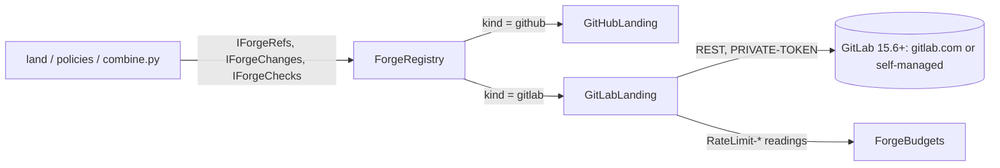

# The GitLab adapter

Paths are relative to `blizzard/src/blizzard/`.

## System



| GitLab server fact                | Value the design relies on                                                                                   |
| --------------------------------- | ------------------------------------------------------------------------------------------------------------ |
| API base (the forge's `api_base`) | `https://gitlab.com/api/v4` for gitlab.com; `<origin>/api/v4` for a self-managed server                      |
| Authentication                    | `PRIVATE-TOKEN: <secret>` header                                                                             |
| Minimum version                   | 15.6, the first to answer `detailed_merge_status`; read from `GET /version`                                  |
| Rate window                       | Per minute; gitlab.com allows about 2,000 authenticated requests a minute                                    |
| Rate headers                      | `RateLimit-Limit`, `RateLimit-Remaining`, `RateLimit-Reset`; a self-managed server may send them on 429 only |
| Paging                            | `per_page=100`, to the GitHub adapter's bounds (`_PAGE_SIZE = 100`, `_PAGE_MAX = 10`)                        |
| Retries and timeouts              | The forges epic's rules ([seam.md](../../../../delivered/advanced-delivery/forges/spec/seam.md))             |

## Domain

```python
# hub/domain/config/forges.py
KNOWN_FORGE_KINDS = frozenset({"github", "gitlab"})

FORGE_KIND_CAPABILITIES: Mapping[str, frozenset[Capability]] = {
    "github": frozenset(Capability),
    # GitLab moves a branch only through a merge request: no refs.advance, branches.merge, refs.create, refs.delete.
    # A GitLab project's merge method (merge commit, semi-linear, fast-forward) is the project's setting, not the
    # request's: changes.merge.merge means "merge by the project's own method"; changes.merge.rebase is not offered.
    "gitlab": frozenset({
        Capability.REFS_READ,
        Capability.COMPARE,
        Capability.COMMITS_READ,
        Capability.CHANGES_OPEN,
        Capability.CHANGES_READ,
        Capability.CHANGES_UPDATE_FROM_BASE,
        Capability.CHANGES_MERGE_MERGE,
        Capability.CHANGES_MERGE_SQUASH,
        Capability.CHECKS_READ,
        Capability.CHECKS_RERUN,
    }),
}

# hub/domain/config/work_sources.py: unchanged. A work source naming a GitLab forge is refused forge_kind_mismatch.
KNOWN_WORK_SOURCE_PROVIDERS = {"github"}
```

```python
# hub/forge/internal/factory.py: the adapter is chosen by kind; the capability check, the policies, and the
# combining step never learn which kind they hold.
kinds = {"github": GitHubLanding, "gitlab": GitLabLanding}

# hub/forge/internal/gitlab_landing.py
class GitLabLanding:  # IForgeAdapter, async as every adapter is
    OFFERED: ClassVar[frozenset[Capability]]  # held equal to FORGE_KIND_CAPABILITIES["gitlab"]

    def __init__(self, binding: ForgeBinding, *, clock: IClock, instrument=None) -> None:
        # Project addressed by its URL-encoded full path, quote(f"{binding.owner}/{binding.repo}", safe=""),
        # since owner may hold "/" (namespaces.md). Every branch name is URL-encoded too.
        # No conditional requests (decision:advanced-delivery/gitlab/no-conditional-reads).
        ...
```

### Vocabulary

Only the seam's words cross; GitLab's stay in `gitlab_landing.py`.

```python
_STATE = {  # merge request state -> ChangeState
    "opened": ChangeState.OPEN,
    "merged": ChangeState.MERGED,
    "closed": ChangeState.CLOSED,
    # GitLab is mid-merge; the next read sees it merged. Mergeability is forced to PENDING.
    "locked": ChangeState.OPEN,
}

_MERGEABILITY = {  # detailed_merge_status -> Mergeability; any status not named here -> BLOCKED
    "mergeable": Mergeability.MERGEABLE,
    "need_rebase": Mergeability.BEHIND,
    "conflict": Mergeability.CONFLICTING,
    "broken_status": Mergeability.CONFLICTING,
    "ci_must_pass": Mergeability.BLOCKED,
    "ci_still_running": Mergeability.BLOCKED,
    "not_approved": Mergeability.BLOCKED,
    "draft_status": Mergeability.BLOCKED,
    "discussions_not_resolved": Mergeability.BLOCKED,
    "merge_request_blocked": Mergeability.BLOCKED,
    "status_checks_must_pass": Mergeability.BLOCKED,
    "checking": Mergeability.PENDING,
    "unchecked": Mergeability.PENDING,
    "preparing": Mergeability.PENDING,
    "approvals_syncing": Mergeability.PENDING,
}

def merged_revision(mr) -> str | None:
    # A fast-forward project puts the head itself on the base.
    return mr["merge_commit_sha"] or mr["squash_commit_sha"] or (mr["sha"] if project_merges_fast_forward else None)

def outcome_of(status: str, allow_failure: bool) -> CheckOutcome:
    match status:
        case "success":
            return CheckOutcome.PASSED
        case "failed":
            return CheckOutcome.NEUTRAL if allow_failure else CheckOutcome.FAILED
        case "skipped" | "manual":
            return CheckOutcome.NEUTRAL
        case "canceled":
            return CheckOutcome.PENDING  # waited out, not charged, as GitHub's "cancelled" is
        case _:
            return CheckOutcome.PENDING  # every running or queued status

# Check.detail = GitLab's own status word; Check.details_url = the job's web_url.
# Change.base_revision = diff_refs.base_sha (read by the head gate, landing.md).
```

## Interfaces

Every route is under the forge's `api_base`; `:id` is the URL-encoded project path.

| Operation          | GitLab call                                                                                   | Notes                                                                                                                    |
| ------------------ | --------------------------------------------------------------------------------------------- | ------------------------------------------------------------------------------------------------------------------------ |
| first call         | `GET /version`                                                                                | Below 15.6: refused `forge_version_unsupported`, naming the version found, before any landing call ([Flows](#flows))     |
| `branch_tip`       | `GET /projects/:id/repository/branches/:branch`                                               |                                                                                                                          |
| `compare`          | `GET /projects/:id/repository/compare?from=&to=&straight=false`                               | The reverse call gives `behind`; `merge_base` from `GET /projects/:id/repository/merge_base`                             |
| `commit_exists`    | `GET /projects/:id/repository/commits/:sha`                                                   |                                                                                                                          |
| `changes`          | `GET /projects/:id/merge_requests?state=opened\|merged\|closed&target_branch=&source_branch=` |                                                                                                                          |
| `recently_closed`  | `GET /projects/:id/merge_requests?target_branch=&state=all&order_by=updated_at&sort=desc`     | Keeps the merged and closed; GitLab lists them as two states. A change merged after a week parked tops the listing       |
| `open_change`      | `POST /projects/:id/merge_requests`                                                           |                                                                                                                          |
| `change`           | `GET /projects/:id/merge_requests/:iid`                                                       | `Change.number` is the `iid`                                                                                             |
| `update_from_base` | `PUT /projects/:id/merge_requests/:iid/rebase`                                                | Answers `Update(method=UpdateMethod.REBASE)`; progress read back with `include_rebase_in_progress=true`                  |
| `merge`            | `PUT /projects/:id/merge_requests/:iid/merge` with `sha` = expected head                      | GitLab checks `sha`; `squash` set for `MergeMethod.SQUASH`                                                               |
| `checks`           | `GET /projects/:id/repository/commits/:sha/statuses`                                          | Without `all=true`: each job and external status at its latest; a retried job counts once                                |
| `change_checks`    | `head_pipeline` from `change`, then `GET /projects/:id/pipelines/:pipeline_id/jobs`           | The merge request's own pipeline, not the head's (`product:gitlab-pipeline-checks`); retried jobs are omitted by default |
| `rerun_check`      | `POST /projects/:id/jobs/:job_id/retry`                                                       | An external status cannot be re-run: `Rerun(RerunOutcome.REFUSED)`                                                       |

`advance_ref`, `merge_into`, `create_ref`, and `delete_ref` are never reached: the registry refuses them
`ForgeCapabilityMissing` before the adapter.

### Failures

Classified under the forges epic's retry rules ([seam.md](../../../../delivered/advanced-delivery/forges/spec/seam.md)).

| GitLab answer                          | Seam result                                                                        |
| -------------------------------------- | ---------------------------------------------------------------------------------- |
| 404                                    | `ForgeNotFound`                                                                    |
| 401, or a 403 that is not a rate limit | `ForgeRejected("auth")`                                                            |
| 429                                    | `ForgeRateLimited(resume_at)`, `resume_at` from `RateLimit-Reset` or `Retry-After` |
| 405, 406, 409, or 422 from `merge`     | The change is re-read; one still open answers `pending`                            |
| A conflict from `rebase`               | `Update(outcome=UpdateOutcome.CONFLICT, method=UpdateMethod.REBASE)`               |
| 5xx, or a timeout                      | `ForgeUnavailable`                                                                 |
| `GET /version` below 15.6              | Refused `forge_version_unsupported`; the visit escalates `forge-config`            |

### Rate budget

```python
# hub/forge/rates.py: a GitLab dialect beside GitHub's (a unit guard holds one per known kind).
RATE_DIALECTS = {"github": GitHubRateDialect(), "gitlab": GitLabRateDialect()}

class GitLabRateDialect:  # IForgeRateDialect
    def reading(self, headers, now) -> BudgetReading | None:
        # RateLimit-Limit, RateLimit-Remaining, RateLimit-Reset -> BudgetReading(CORE_BUCKET, ...). GitLab has one
        # bucket, keyed BudgetKey(forge_id, secret_name) + "core". A server that sends these only on a 429 teaches the
        # budget from refusals alone; its per-minute window keeps the wait short.
        ...

    def refusal(self, status, headers, message, now) -> datetime | None:
        # 429 -> RateLimit-Reset or Retry-After.
        ...

# forge-budget-low and forge-rate-limited: each recorded at most once an hour for a GitLab budget, not once per
# window (decision:advanced-delivery/gitlab/hourly-budget-notices).
```

## Flows

```mermaid
sequenceDiagram
    participant L as land (pass)
    participant A as GitLabLanding
    participant G as GitLab
    L->>A: first operation on this adapter
    A->>G: GET /version
    alt version >= 15.6
        G-->>A: 200 {"version": "16.x"}
        A->>G: the operation's route
        G-->>A: answer
        A-->>L: seam value
    else version < 15.6
        G-->>A: 200 {"version": "15.5.x"}
        A-->>L: refused forge_version_unsupported (names "15.5.x"); no landing call made
        L-->>L: NeedsPerson(EscalationCause.FORGE_CONFIG)
    else 5xx or timeout
        A-->>L: ForgeUnavailable (retried per the forges epic's rules)
    end
```

## Open questions

- Which seam error carries `forge_version_unsupported` to `RepoLanding.ask`, which today escalates `forge-config` only
  for `ForgeNotFound(REPOSITORY)`; and whether the version read is memoized per adapter or per forge. Engineering.
- How `update_from_base(number, expected_head)` honours `expected_head`, since GitLab's rebase route takes no expected
  head. Engineering.
- What a GitLab `compare` answers for `FileChange.blob`, `additions`, `deletions`, `commits_truncated`, and
  `files_truncated`, given GitLab's comparisons carry no blob ids, no per-file line counts, and no total. Engineering.
- How the adapter knows a project merges fast-forward, for `merged_revision`'s last fallback. Engineering.
- Which GitLab fields fill `Change.head`, `base`, `web_url`, and `closed_at`, and how `rerun_check` tells an external
  status's id from a job's. Engineering.
- The module and class names `gitlab_landing.py`, `GitLabLanding`, and `GitLabRateDialect` follow the GitHub adapter's;
  confirm them. Engineering.
- Where the once-an-hour notice floor lives: `ForgeBudgets._notice` keys its window by the reading's reset today, and
  `IForgeRateDialect` has no member for it. Engineering.
