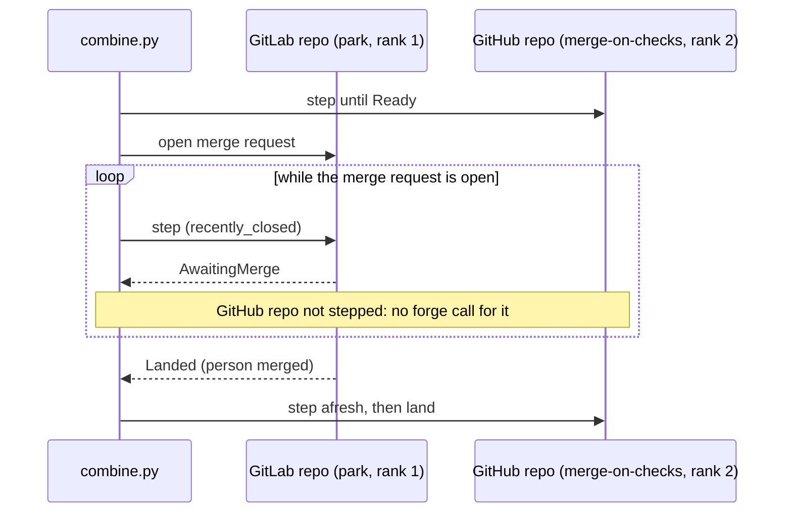

# Landing on GitLab

Paths are relative to `blizzard/src/blizzard/`. No policy changes: `land` runs each repository's policy against the
`RepositoryForge` it is handed
([policies' landing.md](../../../../delivered/advanced-delivery/policies/spec/landing.md)), and the GitLab roles answer
in the seam's words ([adapter.md](./adapter.md)).

## Interfaces

| Policy on a GitLab repository | What differs                                                                                                                          |
| ----------------------------- | ------------------------------------------------------------------------------------------------------------------------------------- |
| `merge-on-checks`             | Checks read through `change_checks`, the merge request's own pipeline; `update_from_base` rebases, so the head passes the rebase gate |
| `park`                        | A person's merge found in `recently_closed`, ordered by update, as on GitHub                                                          |
| `fast-forward`                | Refused: it requires `refs.advance`, which no GitLab repository offers                                                                |

The refusal is the policies epic's capability check, run when a repository is created, its policy is edited, or its
forge is changed, and by the configuration document's apply. So a fast-forwarding repository cannot be moved onto a
GitLab forge either.

```http
PATCH /api/repositories/{repository}
{"landing_policy": "fast-forward"}

422 forge_capability_missing
field: landing_policy
"policy fast-forward needs refs.advance, which forge <forge> doesn't offer"
```

### The rebase head gate

`decision:advanced-delivery/gitlab/rebase-head-gate`. A rebased head does not descend from the submitted commit, so
`gate_head` (`hub/delivery/actions/landing/head_gate.py`) admits it only on the hub's own marker, checked against what
GitLab can say.

```python
# Marker, handed to land's effects when update_from_base answers UpdateMethod.REBASE, before the forge is asked to act.
# <head> is the head it rebases from.
def rebase_marker_name(repo: str, head: str) -> str:
    return f"rebase-requested/{repo}/{head}"

# gate_head: a head that does not descend from the submitted commit is admitted only when ALL hold;
# otherwise it is foreign and the repository answers Failure(foreign_head=True), as today.
admitted = (
    marker_exists(f"rebase-requested/{repo}/{replaced}")  # the hub asked for this rebase, from `replaced`
    and change.base_revision == base_tip                  # diff_refs.base_sha is the base's current tip
    and commits_past(base_tip, head) == commits_past(base_of(replaced), replaced)
    and paths_changed(base_tip, head) == paths_changed(base_of(replaced), replaced)
)
# Not admitted: a rebase nobody requested, a person's push after the rebase, a rebase that dropped or added a path.
```

## Flows

```mermaid
sequenceDiagram
    participant P as merge-on-checks (pass n)
    participant E as land's effects (store)
    participant G as GitLab
    participant Q as merge-on-checks (pass n+1)
    P->>G: change(iid)
    G-->>P: detailed_merge_status need_rebase -> Mergeability.BEHIND, head H1
    P->>E: rebase-requested/<repo>/H1
    Note over P,E: crash point policy.after-rebase-marker.before-request
    P->>G: PUT .../merge_requests/:iid/rebase
    alt accepted
        G-->>P: accepted
        P-->>P: Waiting
    else conflict
        G-->>P: conflict
        P-->>P: Conflict
    end
    Q->>G: change(iid)
    G-->>Q: head H2, diff_refs.base_sha
    Q->>Q: gate_head(H2): marker for H1, base tip, commit count, path set
    alt all hold
        Q-->>Q: admitted; checks read from the merge request's pipeline
    else any fails
        Q-->>Q: Failure(foreign_head=True)
    end
```

### Landing across kinds of forge

`combine.py` folds the states without reading their kinds, under the policies epic's rules
([policies' landing.md](../../../../delivered/advanced-delivery/policies/spec/landing.md#combining-a-chunks-repositories)).
Each commit pointer resolves to its own record, and the visit holds both repositories' flows. The two writes go to two
forges and are never one atomic act.

```mermaid
sequenceDiagram
    participant C as combine.py
    participant GH as GitHub repo (merge-on-checks, rank 1)
    participant GL as GitLab repo (merge-on-checks, rank 2)
    C->>GH: step
    C->>GL: step
    Note over C: lands nothing until every repository the hub lands itself is Ready
    C->>GH: land (merge)
    GH-->>C: Landed, merged/<repo>
    C->>GL: land (merge)
    alt merged
        GL-->>C: Landed -> pass answers landed
    else refused
        GL-->>C: refused; the GitHub repository stays landed
        Note over C: the chunk reconciles as the policies epic says: a later visit lands only what is left
    end
```



## Data

| Crash point (`bzh:crash-point-registry`)    | Between                                                              | The next pass                                          |
| ------------------------------------------- | -------------------------------------------------------------------- | ------------------------------------------------------ |
| `policy.after-rebase-marker.before-request` | `rebase-requested/<repo>/<head>` is durable; no rebase was requested | Sees the head unchanged, and requests the rebase again |

Reached by a `blizzard:crash-sweep` scenario (`crashpoint(...)` in `foundation/crash.py`).

## Open questions

- Which revision "the replaced head's own base" is for `commits_past` and `paths_changed` (the merge base of the
  replaced head and the base branch, or `diff_refs.base_sha` as last read), and which seam calls answer them given
  GitLab's comparisons carry no total. Engineering.
- How `gate_head(repo, head)` reaches the markers and the change's `base_revision`; it takes the repository and head
  only today. Engineering.
- The `rebase-requested` marker's content, and the helper's name and module (`pr_markers.py` holds the other numbered
  markers). Engineering.
