# The flow's own train

Paths are relative to `blizzard/src/blizzard/`. The train runs on a repository whose `batch_size` is above one
([capabilities.md](./capabilities.md#the-batching-settings)); its record is [record.md](./record.md).

## System

| Module                                       | Holds                                                                      |
| -------------------------------------------- | -------------------------------------------------------------------------- |
| `hub/delivery/trains/readiness.py`           | Whether a submission is ready on a batching flow ([Readiness](#readiness)) |
| `hub/delivery/trains/train.py`               | Forming, building, proving, holding, and landing a batch                   |
| `hub/delivery/trains/split.py`               | Splitting a failed batch                                                   |
| `hub/delivery/trains/eject.py`               | Ejecting a member, and a member leaving every other batch                  |
| `hub/delivery/actions/landing/combine.py`    | Folds `Queued` into a visit's pass                                         |
| `hub/delivery/flow_driver.py` (`FlowDriver`) | Takes the train turn ([record.md](./record.md#the-train-turn))             |

`hub/delivery/trains/` is under `bzh:hub-action-purity`, as `hub/delivery/actions/` is: the import allowlist
(`tests/guards/test_layering.py::test_hub_actions_import_only_their_allowlist`) and the frozen-input check
(`tests/unit/hub/delivery/test_action_registry.py`) walk both.

| Bound                       | Value                                   | Read from                                          |
| --------------------------- | --------------------------------------- | -------------------------------------------------- |
| `TRAIN_POLL_SECONDS`        | 30 s                                    | The driver's clock; a proof read, or a hold's read |
| `TRAIN_PROOF_START_SECONDS` | 600 s, from the train branch's creation | The driver's clock                                 |
| `TRAIN_PROOF_TIMEOUT`       | 3 h, from the train branch's creation   | The driver's clock; equals `DEFAULT_POLL_TIMEOUT`  |
| Rebuilds before fallback    | 3                                       |                                                    |
| Re-runs per failing check   | 1, per proof                            |                                                    |

Every bound reads the clock the driver hands the step, so tests set it.

## Domain

```python
# hub/delivery/actions/landing/repo.py
@domain_model
@dataclass(frozen=True)
class Queued:
    """Prepared and handed to a train — the flow's own or a forge's queue — which lands it."""


type RepoState = (
    Landed | NoCode | Ready | Waiting | Held | AwaitingMerge | Queued | Conflict | Failure | Inherited | NeedsPerson
)
```

```python
# hub/delivery/trains/train.py — one train step; runs on the ActionLoop as an action does.
class ITrainStep(Protocol):
    async def step(self, batch: Batch, forge: RepositoryForge, effects: IEffectSink): ...
    # batch: frozen (record.md#domain) — its members, their revisions, its facts so far, the flow's repository and
    #   settings. Anything more is declared as an input the driver loads; a step never reads the store.
    # forge: the flow's repository's RepositoryForge.
    # effects: each fact is handed over and made durable by the driver before the step continues, so a forge write
    #   and its record are never more than one crash point apart (record.md#crash-points).
```



```mermaid
stateDiagram-v2
    [*] --> building: formed
    building --> proving: every member merged; train branch created
    building --> building: a member left (merged onto base, not onto members ahead)
    proving --> landed: green, advance_ref accepted
    proving --> building: advance stale (rebuild on the new tip, up to 3)
    proving --> split: a failure the base does not share
    proving --> abandoned: unproven | outpaced | advance-refused | proof-timed-out | member-left
    building --> abandoned: member-left
    landed --> [*]
    split --> [*]
    abandoned --> [*]
```

A batch's state is derived, never stored ([record.md](./record.md#data)).

## Readiness

```python
# hub/delivery/trains/readiness.py — engineering:mechanical-joins, engineering:train-order
def ready(submission, repo) -> bool:
    return (
        visit_wrote(f"train-ready/{repo}")  # at the submitted revision, by the visit's land pass
        and chunk.status == "delivering"
        and open_on_every_flow_it_holds(submission)
        and not own_checks_failed(submission)  # failed: answered as merge-on-checks answers, never joins
        # Strict order: unranked after ranked, ties by slug (landing_sort_key), from the landing terms fixed at the
        # visit's first turn. A chunk reaching two batching repositories joins their trains one after the other.
        and every_earlier_repository_landed(chunk, before=repo)
    )
```

A member's own checks need not have finished for it to join. One whose own checks failed answers as `merge-on-checks`
answers a failing change: `failure` with findings, or `inherited-failure` when the base shares every failure after the
one re-run.

A visit's `land` pass on a batching repository runs only its policy's preparation, then hands the repository to the
train:

| Policy            | Preparation                                                            | Then                                 |
| ----------------- | ---------------------------------------------------------------------- | ------------------------------------ |
| `merge-on-checks` | Find or open the change; write `delivery-pr/<repo>/<n>`; gate the head | `Queued`; write `train-ready/<repo>` |
| `fast-forward`    | Gate the head                                                          | `Queued`; write `train-ready/<repo>` |

Each later pass reads the flow's verdict from the flow's record and routes through the visit's own routing, as for a
submission landed alone:

| Flow's record says          | `RepoState`                          |
| --------------------------- | ------------------------------------ |
| A batch carried it in       | `Landed` at the batch's revision     |
| Ejected                     | The ejection's verdict               |
| Neither                     | `Queued`                             |
| `train-fallback/<repo>` set | The policy's own path, landing alone |

```python
# hub/delivery/actions/landing/combine.py — how Queued folds
# Chunk atomicity: Queued counts as prepared, as Ready does; nothing lands until every repository the hub
#   lands itself is prepared.
# Landing order: Queued is unlanded; every repository after it waits for its Landed.
# Answer: every unlanded repository Queued, or waiting behind one -> "awaiting-queue" (record.md#awaiting-the-queue),
#   never "pending"; "awaiting-merge" wins when a parked change is among them.
```

## Flows

### Forming and a lone member

```python
# FlowDriver, on a flow with no batch in progress and no hold — at most one batch in progress per flow
due = len(ready) >= batch_size or now - oldest(ready).ready_at >= batch_wait_seconds
batch = ready_in_arrival_order[:batch_size]

# engineering:one-proof-per-batch — a batch of one needs no train when its member's revision holds the base's tip
# and is green on its own revision with the shared reading (at least one check, each passed or neutral), under
# either policy:
await forge.refs.advance_ref(base, expected=tip, revision=member.revision)
# Refused (stale or protected): the member goes to the train like any other.
```

### Building, proving, landing

```mermaid
sequenceDiagram
    participant D as FlowDriver (train turn)
    participant F as Forge
    D->>F: create_ref(<staging_prefix><flow_id>/<batch_id>, base tip)
    Note over D: batch-formed; base_revision = tip
    loop each member, arrival order
        D->>F: merge_into(staging, member.revision)
        alt merged
            Note over D: member merged_revision recorded
        else conflict, first member (bare base)
            Note over D: ejected conflict
        else conflict onto members ahead only
            Note over D: leaves the batch, keeps its place in the line
        end
    end
    D->>F: create_ref(<train_prefix><flow_id>/<batch_id>, staging tip)
    D->>F: delete_ref(staging)
    Note over D: batch-built; revision = train tip
    loop every TRAIN_POLL_SECONDS
        D->>F: checks(revision)
    end
    alt green
        D->>F: advance_ref(base, expected=base_revision, revision)
        alt accepted
            Note over D: record_batch_landed (record.md#the-landed-event)
            D->>F: close_change(n, comment) for each merge-on-checks change still open
            D->>F: delete_ref(train)
        else ForgeRejected("stale")
            Note over D: rebuild on the new tip, same members; 4th time: fallback, train-outpaced
        else ForgeRejected("protected")
            Note over D: abandoned advance-refused; train-advance-refused (critical);<br/>probe records advance_refused_at; fallback
        end
    else a failure the base does not share
        Note over D: split (below)
    else only failures the base shares
        D->>F: rerun_check(id) once each
        Note over D: still red: eject oldest inherited-failure,<br/>rest to head of line, hold
    else no check after TRAIN_PROOF_START_SECONDS
        Note over D: abandoned unproven; train-unproven; fallback
    else unfinished at TRAIN_PROOF_TIMEOUT
        D->>F: rerun_check(id) for each unfinished; bound restarts
        Note over D: still unfinished: abandoned proof-timed-out;<br/>train-proof-timed-out naming the checks; members to head of line
    end
```

- A conflict onto members ahead only is not a conflict: once they land the member meets them as base, and conflicts, if
  it still does, as the first member of a later batch. Every batch's first member merges or is ejected, so the line
  always moves.
- Checks run once per batch, on the train branch's finished tree; none run on the staging branch.
- Fallback: each member lands alone through its policy for this submission; `train-fallback/<repo>` is written so its
  next passes take the policy's own path.
- The base after a landing holds exactly the proven tree; nothing assembled after the proof reaches it.
- Each `merge-on-checks` member's change is read back: GitHub marks it merged once its head is reachable from the base;
  one still open is closed with `close_change`, its comment naming the revision that carried it in.
- A rebuilt, split, or abandoned batch deletes its staging and train branches as it leaves them; a rebuild recreates
  both at the new tip. No branch outlives its batch.
- `train-unproven` names the repository and the train; `train-advance-refused` names the repository.

### Splitting

```python
# hub/delivery/trains/split.py — engineering:split-bound, decision:advanced-delivery/trains/split-by-arrival-order
# Only a prefix ever lands. Each halving costs at most two proofs; a batch of 8 with one bad member lands 7 in <= 7.
async def on_failure(batch):
    if len(batch.members) == 1:
        rerun_failing_checks_once()  # a flaky check costs no place
        if still_red:
            eject(member, "failure", findings=failing_checks_on(batch.revision))  # also delivery-findings
            return_to_head_of_line(other_members_of(batch.split_from))
        return
    first, second = halves_by_arrival(batch)
    half = form(first, base=batch.base_revision, split_from=batch.batch_id)  # batch-split fact, then built and proven
    # half passes: it lands; `second` returns to the head of the line and the next batch proves it on the new base.
    # half fails: on_failure(half).
```

### Holding

```python
# engineering:train-bounds — a flow holds after its last batch ejected a member inherited-failure.
while held:  # forms no batch and lands no lone member
    await sleep_until(TRAIN_POLL_SECONDS)
    if green(await forge.checks.checks(base)):  # base's current tip: the tip that failed re-run, or a newer repair
        release()  # train-released fact and event
# Held members answer awaiting-queue: the hold costs them time, not bounces.
```

`train-held` is written as a fact and an event when the hold begins; the lane says why the flow is still.

### Ejecting and leaving

An ejection is an `ejected` fact on the flow naming the batch, the outcome (`conflict`, `failure`, `inherited-failure`),
and the findings, also written as the member's `delivery-findings`. The member's visit answers that outcome on its next
pass and routes along the edge its graph authored, as if it had landed alone and failed; its submission closes on every
flow it held.

| Event on a member                              | Batch still building | Batch proving                                  | After the batch's advance          |
| ---------------------------------------------- | -------------------- | ---------------------------------------------- | ---------------------------------- |
| Ejected from another repository's batch        | Leaves it            | Abandoned `member-left`, `left-batch`; rebuilt | The landing stands and is recorded |
| Withdrawn by a lever (stop, restart, complete) | Leaves it            | Abandoned `member-left`; rebuilt without it    | Landed; recorded as any member     |

A withdrawal takes its outcome from `withdrawal_for`, deferred to the end of any turn still open on it, as the flows
epic withdraws any submission. A chunk turned back to an agent, or stopped by a person, never has that work landed by a
proof that finished after.

## Open questions

- The effect types a train step hands to `IEffectSink` for its facts are not named; today's `Effect` union is `Marker`,
  `LandingRecord`, `RecordReviewFindings`, and `RecordGardenDelivery`. Engineering.
- What `step` answers is not stated; [record.md](./record.md#the-train-turn) gives only the turn outcomes `pending` and
  `interrupted`. Engineering.
- Whether `Queued` carries any field. Engineering.
- How long a submission has been ready (`batch_wait_seconds` is measured from it) is read from the `train-ready`
  marker's `produced_at` or elsewhere. Engineering.
