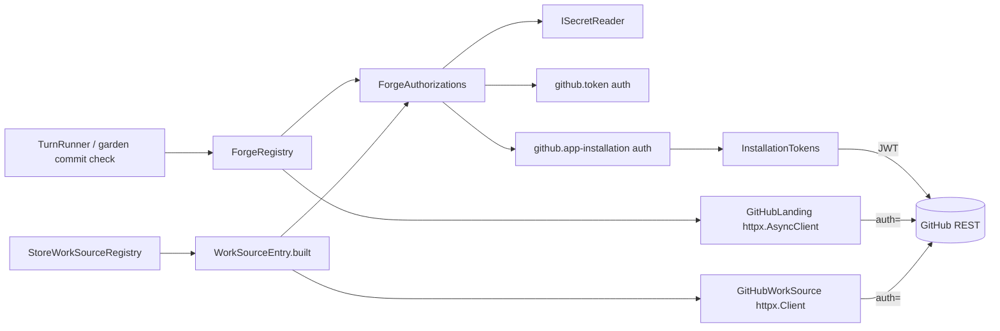
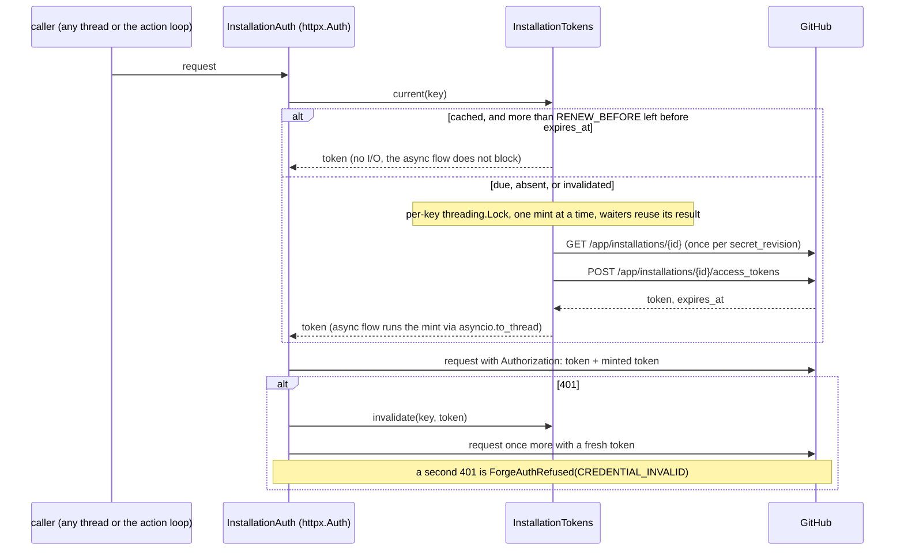

# Forge authorization

Paths are relative to `blizzard/src/blizzard/`.

## System



`ForgeAuthorizations` is the only caller of `ISecretReader.reveal` for forge credentials. `ForgeRegistry._build_current`
(`hub/forge/registry.py`) and `WorkSourceEntry.built` (`hub/work_sources/internal/factory.py`) stop revealing. The
reveal guard in `tests/guards/test_layering.py` narrows to `hub/forge/internal/`.

GitHub limits the design relies on:

| Limit                                               | Value                                                               |
| --------------------------------------------------- | ------------------------------------------------------------------- |
| Installation access token lifetime                  | 1 h, from the mint answer's `expires_at`                            |
| App JWT lifetime                                    | at most 10 min                                                      |
| Installation rate limit                             | per installation, shared by every token minted for it               |
| Check-run re-request (`/check-runs/{id}/rerequest`) | the owning App only; landing keeps using `/actions/jobs/{id}/rerun` |

## Domain

```python
# hub/forge/auth.py
class ForgeScope(StrEnum):
    LANDING = "landing"
    WORK_SOURCE = "work-source"
    CHECK = "check"                 # the readiness check: read-only calls of both

@dataclass(frozen=True)
class ForgeAuthorization:
    credential_id: CredentialId | None   # None: an implicit github.token for a referrer with no credential_id
    credential_slug: str | None          # None alike; diagnostics then name the secret
    binding: str
    variant: str | None             # github.token only: "classic" | "fine-grained" | "unspecified"
    authority: str                  # keys budgets and write locks
    offered: frozenset[Capability]  # runtime offer: declared_offers, narrowed by the token or the installation
    auth: httpx.Auth                # sync_auth_flow and async_auth_flow; one object serves both clients

class IForgeAuthorizations(Protocol):
    def authorization(self, credential: ResolvedCredential, scope: ForgeScope) -> ForgeAuthorization: ...
        # raises CredentialUnavailable: unknown or retired credential or secret
```

```python
# hub/domain/config/credentials.py
@dataclass(frozen=True)
class ResolvedCredential:
    credential_id: CredentialId | None   # None: a referrer whose credential_id is still NULL
    forge_id: ForgeId; binding: str; secret_name: str; settings: Mapping[str, object]
    revision: int; authority: str

def resolve_credential(record: RepositoryFields | WorkSourceFields, credentials: IReadCredentialRepository) -> ResolvedCredential | None:
    # credential_id set: that credential, retired or not.
    # credential_id NULL and secret_name set: an implicit github.token with no variant, authority secret/<secret_name>.
    # neither: None, an anonymous work source.
```

`CredentialUnavailable` is refused by `TurnRunner` as `repository-secret-unavailable`, unchanged
(`hub/delivery/flow_turn.py`). `ForgeBinding.token: str` becomes `ForgeBinding.authorization: ForgeAuthorization`.
`GitHubLanding._http` builds `httpx.AsyncClient(auth=binding.authorization.auth)` with no fixed `Authorization` header;
`WorkSourceEntry.built` builds its `httpx.Client` the same way. `ForgeRegistry.offered(forge, repository)` answers the
repository's `authorization.offered` when `repository` is given, and the kind's set otherwise.

**`github.token` effective variant**, computed at build from the revealed value (`hub/forge/internal/github_auth.py`):

| Declared `variant`  | Token prefix                 | Effective      |
| ------------------- | ---------------------------- | -------------- |
| any                 | `github_pat_`                | `fine-grained` |
| `fine-grained`      | any                          | `fine-grained` |
| `classic` or absent | `ghp_`, or 40 hex characters | `classic`      |
| `classic`           | other                        | `classic`      |
| absent              | other                        | `unspecified`  |

`offered` is the kind set less `FINE_GRAINED_WITHHELD` for `fine-grained`, and the kind set otherwise. The token and its
prefix are never logged or returned; `variant` is.

**`github.app-installation` scopes.** A mint requests the scope's permissions intersected with the installation's
granted ones:

| Scope         | Required                                                                  | Optional, and the capability withheld when not granted            |
| ------------- | ------------------------------------------------------------------------- | ----------------------------------------------------------------- |
| `landing`     | `metadata: read`, `contents: write`, `pull_requests: write`               | `checks: read` → `checks.read`; `actions: write` → `checks.rerun` |
| `work-source` | `metadata: read`, `issues: write`, `pull_requests: read`                  | none                                                              |
| `check`       | `metadata: read`, `contents: read`, `pull_requests: read`, `issues: read` | `checks: read`                                                    |

`pull_requests: read` is required because the batch fetch reads each ref through GraphQL `issueOrPullRequest`
(`hub/work_sources/internal/github_work_source.py::_batch_query`), which resolves a pull request's number too. A
required permission not granted raises `ForgeAuthRefused(PERMISSION_MISSING)` at mint ([refusals.md](./refusals.md)).

```python
# hub/forge/internal/github_auth.py
class InstallationTokens:   # one per tenant, built in hub/composition.py beside ForgeBudgets
    def current(self, key: InstallationKey) -> MintedToken: ...         # thread-safe
@dataclass(frozen=True)
class InstallationKey:
    forge_id: ForgeId; authority: str; scope: ForgeScope; secret_revision: int
@dataclass(frozen=True)
class MintedToken:
    token: SecretValue; expires_at: datetime; permissions: Mapping[str, str]
RENEW_BEFORE = timedelta(minutes=5)
```

## Interfaces

GitHub calls the App binding makes, against the forge's `api_base`:

```text
GET  /app/installations/{installation_id}                    Authorization: Bearer <app JWT>
     200 { "permissions": {...}, "suspended_at": null|ts }   404 installation-missing   401 key-rejected
POST /app/installations/{installation_id}/access_tokens      Authorization: Bearer <app JWT>
     { "permissions": {<scope's permissions ∩ granted>} }
     201 { "token", "expires_at", "permissions" }            401 key-rejected   404 installation-missing
     403 (suspended) installation-suspended                   422 permission-missing
```

App JWT: RS256 via `pyjwt[crypto]`, claims `iss = app_id`, `iat = now - 60 s`, `exp = now + 540 s`, `now` from the
injected `Clock`.

`hub/forge/budget.py`:

```python
@dataclass(frozen=True)
class BudgetKey:
    forge_id: ForgeId
    authority: str      # was secret_name; decision:advanced-forge-auth/one-credential-per-authority
```

`WriteLocks` (`hub/forge/registry.py`) keys on `(forge_id, authority)`. Budget notices (`hub/forge/budget_notices.py`)
carry `"authority"` in their detail, and keep `"secret"` for a `github.token` authority. Mint and installation reads are
App-authenticated and spend no installation budget.

`CacheKey` (`hub/live_config/__init__.py`) gains `credential_id` and `credential_revision`; its `secret_name` and
`secret_revision` become the credential's secret's. `ConfigRevisionsStore` outer-joins `credentials`.

The proof tool, `blizzard/tools/proofs/github_private_checks.py`, serves `engineering:private-checks-proof`:

```text
github_private_checks.py --api-base URL --repo OWNER/REPO --pull N --expect NAME=CONCLUSION ...
    --app-id N --installation-id N --key-file PATH
    env: PROOF_CLASSIC_TOKEN, PROOF_FINE_GRAINED_TOKEN
stdout, one line per credential:  <app|classic|fine-grained> pull=<status> check-runs=<status> matched=<yes|no>
exit 0 when the App line is pull=200 check-runs=200 matched=yes
```

It makes no call but `GET /repos/{o}/{r}/pulls/{n}`, `GET /repos/{o}/{r}/commits/{head}/check-runs`, and the mint. It
prints no token, body, or check name.

## Flows



Minted tokens are held in memory only (`decision:advanced-forge-auth/tokens-in-memory`). After a restart the first
request mints. A replaced key moves `secret_revision` and mints under a new key; tokens under the old key are dropped. A
credential edit rebuilds adapters through `CacheKey` and reuses a live token whose `InstallationKey` is unchanged.
