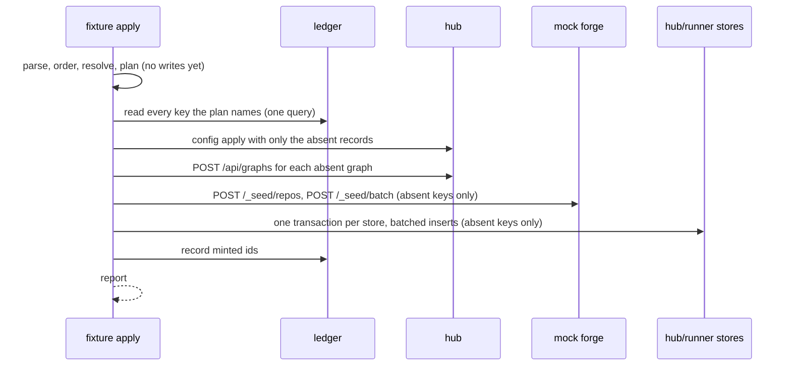

# Fixture format and apply

The fixture file, how `fixture apply` processes it, and the writers it feeds.

## System

```text
blizzard-mock-data fixture apply <file | dir>...
  1. parse     each file ─► read `kind` ─► validate against that kind's model (unknown or missing fields refused, file:line)
  2. order     sort files by kind: shell, codebase, backlog, graphs, gardening, runners, activity
  3. resolve   plain keys ─► the env's records (ledger, then the stores); an unknown key is refused
  4. plan      typed records ─► writes, each with one destination
  5. write     skip keys the ledger holds ─► batched writes per destination ─► record minted ids ─► report
```

Nothing is written until steps 1 to 4 pass for every file given.

| Kind      | Holds                                                         | Written to                                                        |
| --------- | ------------------------------------------------------------- | ----------------------------------------------------------------- |
| shell     | forges, sources, repositories, projects, urgencies; people    | hub `config apply`; hub store (people)                            |
| codebase  | a repository's files and commit history                       | mock forge `POST /_seed/repos`                                    |
| backlog   | labels, issues and their threads; hub-authored work items     | mock forge `POST /_seed/batch`; hub `POST /api/work-sources/hub/items` |
| graphs    | graph definitions                                             | hub `POST /api/graphs`                                            |
| gardening | scopes, routines, cadences; garden proposals                  | hub `config apply`; hub store (proposals)                         |
| runners   | hosts and runners, their presence, brakes, usage samples      | hub store                                                         |
| activity  | chunks and their history; the event log                       | hub store; mock forge (pull requests); runner store (`self` mirror) |

Configuration-shaped records go through the hub's own `config apply` and graph API, so the hub enforces its rules on
them. Direct store writes are kept to records with no public write path (engineering:bulk-apply).

## Domain

```python
class Fixture(BaseModel, extra="forbid"):
    fixture: Literal[1]          # format version; an unknown one is refused
    kind: str
    name: str

class ShellFixture(Fixture):
    kind: Literal["shell"]
    forges: list[Forge] = []                 # these six are records of the hub's version 2
    secrets: list[str] = []                  # config document, with the same fields
    work_sources: list[WorkSource] = []
    repositories: list[Repository] = []
    projects: list[Project] = []
    urgencies: list[Urgency] = []
    urgency_order: list[str] = []
    settings: Settings | None = None
    people: list[Person] = []
    invitations: list[Invitation] = []

class CodebaseFixture(Fixture):
    kind: Literal["codebase"]
    repo: RepoRef
    history: list[Commit]                    # oldest first; Commit.files maps path to whole content

class BacklogFixture(Fixture):
    kind: Literal["backlog"]
    labels: list[RepoLabels] = []
    issues: list[Issue] = []
    hub_items: list[HubItem] = []

class GraphsFixture(Fixture):
    kind: Literal["graphs"]
    packaged: list[str] = []                 # bundled graphs the hub syncs at boot, named so references resolve
    graphs: list[GraphDefinition] = []

class GardeningFixture(Fixture):
    kind: Literal["gardening"]
    scopes: list[Scope] = []
    routines: list[Routine] = []
    cadences: list[Cadence] = []
    proposals: list[Proposal] = []

class RunnersFixture(Fixture):
    kind: Literal["runners"]
    hosts: list[Host] = []
    runners: list[Runner] = []

class ActivityFixture(Fixture):
    kind: Literal["activity"]
    defaults: ChunkDefaults | None = None
    chunks: list[Chunk] = []
    events: list[Event] = []
    generate: EventFiller | None = None

AnyFixture = Annotated[
    ShellFixture | CodebaseFixture | BacklogFixture | GraphsFixture
    | GardeningFixture | RunnersFixture | ActivityFixture,
    Field(discriminator="kind"),
]
```

A chunk is a union on `status`, so each status carries exactly the fields it needs:

```python
class NeedsHuman(ChunkBase):
    status: Literal["needs_human"]
    escalation: Escalation                   # required

class WaitingOnHuman(ChunkBase):
    status: Literal["waiting_on_human"]
    question: Question | None = None
    decision: Decision | None = None         # exactly one of question, decision

Chunk = Annotated[
    NotReady | Ready | Running | Delivering | Paused | WaitingOnHuman | NeedsHuman | Done | Stopped,
    Field(discriminator="status"),
]
```

The models export a JSON Schema, published beside the library, so an editor or an agent validates a fixture while
writing it.

### Keys and references

```yaml
issues:
  - key: checkout-500          # a record's own key, unique within its kind in the env
chunks:
  - work: [checkout-500]       # a reference is the plain key of a record of the kind the field names
    runner: build-box-1
    project: default           # slug-keyed records are referenced by slug
    runner: self               # reserved: the env's own runner, read from $BZ_RUNNER_RUNTIME's host file
```

A reference resolves against the fixtures in the same apply first, then against what earlier applies left in the env.

`--prefix p17-` prefixes every key and slug the applied files declare and every reference among them, so one fixture
applied with a thousand prefixes gives a thousand copies (product:fixture-targets).

### Time

```yaml
at: -3h                        # relative to the apply instant: s, m, h, d; compound -2d4h
at: -2d+40m                    # an offset from an offset, for steps within one past moment
resets_at: +40m                # future instants, for windows and expiries
at: now
```

A relative time is resolved once, when its record is created, and never rewritten.

### Presence

```yaml
presence: online               # last_seen_at = apply instant; reads online for the hub's offline cutoff (4 h in feature envs)
presence: offline              # last_seen_at = -8h unless `last_seen` says otherwise; must be older than the cutoff
presence: never-connected      # added, never registered
```

### Generated filler

```yaml
transcript:
  generate: {turns: 40, tool_use: 0.3}   # alternating turns; 30% of assistant turns call a tool and get a result
  then:                                  # spelled-out turns appended after the generated ones
    - {role: assistant, text: "Tests pass locally. Opening the pull request."}
thread:
  generate: {comments: 12, authors: [lee, sam, dana]}
usage:
  generate: {every: 1h, for: 7d, models: [claude-sonnet-5-5], cost_per_call: [0.02, 0.40]}
body:
  generate: {paragraphs: 3}
```

- Each generator's seed is `hash(seed, prefix, key, field)`; `--seed N` sets the first, default 1. Same inputs, same
  output, byte for byte.
- A transcript is written in the Claude-Code JSONL shape the mock harness already writes (`blizzard_mock.harness`), so
  the runner's transcript reader serves it unchanged.

## Interfaces

### CLI

```text
blizzard-mock-data fixture apply <file | dir>...
    (--env <name> | --hub-dir D --runner-dir D --forge-url U --hub-url U)
    [--prefix P] [--seed N] [--tenant T] [--dry-run] [--report text|json]
blizzard-mock-data fixture check <file | dir>...    # steps 1 to 4 only; writes nothing
blizzard-mock-data fixture schema                   # prints the JSON Schema
```

`--env` resolves every target from `winter env <name>`. A directory is applied as every `*.yaml` in it.

### Report

```json
{
  "created":   {"chunk": 19, "issue": 25, "runner": 7, "project": 1},
  "unchanged": {"graph": 1, "repository": 2},
  "unreconciled": [
    {"key": "checkout-500", "reason": "chunk exists with status running; fixture declares done"}
  ],
  "seconds": 4.2
}
```

Exit 0 when `unreconciled` is empty, 3 when it is not, 2 on a refusal before any write.

### Mock forge seed routes

```text
POST /_seed/repos     {owner, name, default_branch, history: [{message, author, at, files: {path: content}}]}
                      201 created | 200 identical repo exists | 409 repo exists with different history
POST /_seed/batch     {items: [{op: issue|comment|label|pull|checks, key, ...}]}
                      200 {results: [{key, number?, created: bool}]}; an item whose key exists is skipped
```

Both are new. The forge's issue, pull request, comment, label, and check state moves from memory to a sqlite file beside
`$BZ_FORGE_REPOS_DIR`, so what a fixture created outlives a forge restart (product:one-world).

## Flows



- A key the ledger holds whose id the store no longer has, after a `reset`, is dropped and its record created again.
- A graph is matched by `name` against the tenant's effective graph of that name. Every `POST /api/graphs` mints a new
  immutable version, so a graph whose name exists is never posted again; a differing `definition_yaml` is reported
  unreconciled.
- A failure in one writer stops the apply. Writes already made stay, and the next apply skips them.
- Chunks run by `self` are mirrored into the runner store only after the runner's local pause is written, as
  `scenario fleet` does today.

## Data

```sql
-- $BZ_HUB_RUNTIME/fixtures/ledger.db
CREATE TABLE fixture_keys (
  kind       TEXT NOT NULL,          -- issue, chunk, runner, ...
  key        TEXT NOT NULL,          -- prefix included
  store      TEXT NOT NULL,          -- hub | runner | forge
  minted_id  TEXT NOT NULL,          -- chk_..., issue number, rn_...
  created_at TEXT NOT NULL,
  PRIMARY KEY (kind, key, store)
);
```

## Open questions

- Whether the hub has a read of the live config document an apply can add to, or the apply keeps its own record of the
  config records it created.
- How a second tenant is created in a feature env's hub, for fixtures applied with `--tenant`.
- Whether people in a shell fixture also feed the mock IdP's profiles, so a seeded person can sign in as themselves.
