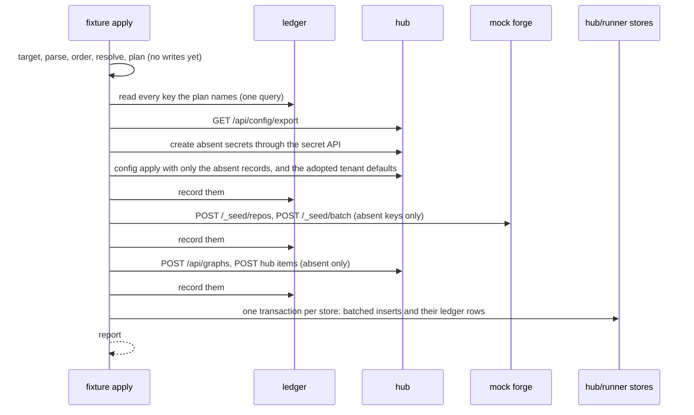

# Fixture format and apply

The fixture file, how `fixture apply` processes it, and the writers it feeds.

## System

```text
blizzard-mock-data fixture apply <file | dir>...
  0. target    the env's hub, forge, and stores ─► refused unless they are a feature env's own (engineering:env-only-targets)
  1. parse     each file ─► substitute ${VAR} ─► read `kind` ─► validate against that kind's model (file:line on refusal)
  2. order     sort files by kind: shell, codebase, backlog, graphs, gardening, runners, activity
  3. resolve   plain keys ─► the env's records (ledger, then the stores); graph node names ─► the chunk's graph
  4. plan      typed records ─► writes, each with one destination; existing keys compared, differences → unreconciled
  5. write     per destination, in kind order: one batch of writes ─► its ledger rows in the same step ─► next destination
```

Nothing is written until steps 0 to 4 pass for every file given.

| Kind      | Holds                                                         | Written to                                                                    |
| --------- | ------------------------------------------------------------- | ----------------------------------------------------------------------------- |
| shell     | forges, secrets, sources, repositories, projects, urgencies; people | hub `config apply` and secret API; hub store (people, invitations)     |
| codebase  | a repository's files and commit history                       | mock forge `POST /_seed/repos`                                                |
| backlog   | labels, issues and their threads; hub-authored work items     | mock forge `POST /_seed/batch`; hub `POST /api/work-sources/hub/items`        |
| graphs    | graph definitions                                             | hub `POST /api/graphs`                                                        |
| gardening | scopes, routines, cadences; garden proposals                  | hub `config apply`; hub store (proposals)                                     |
| runners   | hosts and runners, their presence, brakes, usage samples      | hub store                                                                     |
| activity  | chunks and their history; the event log                       | hub store; mock forge (pull requests, branches); runner store (`self` mirror) |

Configuration-shaped records go through the hub's own `config apply`, secret API, graph API, and work-item API
(engineering:public-paths). The stores are written directly only for these, none of which has a public create path that
accepts a past state: people and invitations (sign-in mints them), garden proposals (a routine run mints them), hosts
and runners (registration mints them, always as now), and chunks with their history, leases, decisions, bounces,
usage, and event rows (the fleet mints them by running).

## Domain

Every enum below mirrors a blizzard enum by value. mock-data imports nothing from blizzard, so a contract test reads
blizzard's enums and fails when the two differ, the way the schema drift guard does for tables.

| Enum here          | Mirrors (blizzard)                                    | Values                                                                 |
| ------------------ | ----------------------------------------------------- | ---------------------------------------------------------------------- |
| `Status`           | `foundation/chunk_status.py: ChunkStatus`             | the nine derived statuses                                              |
| `EscalationCause`  | `foundation/escalation_causes.py`                     | `retries-exhausted`, `spend-cap`, `bounce-cap`, `forge-auth`, … (18)   |
| `Lever`            | `foundation/declared_lever.py: DeclaredLever`         | `floor`, `pace`, `utilization`, `budget`, `schedule`                   |
| `ClosureKind`      | `foundation/garden_proposals.py`                      | `passed`, `accepted`                                                   |
| `ItemOutcome`      | `foundation/garden_proposals.py`                      | `minted`, `declined`                                                   |
| `Role`             | `auth_core: Role`                                     | `guest`, `contributor`, `admin`: a subset; the test checks each exists |
| `MissReason`       | `foundation/subscription_miss.py: SampleMissReason`   | `credential_lapsed`, `credential_unreadable`, `endpoint_unreachable`, … |
| `Priority`         | `WorkItemPriority`                                    | `low`, `normal`, `high`                                                |
| `LandingPolicy`    | `foundation/landing_policy.py`                        | `merge-on-checks`, `fast-forward`, `park`                              |
| `EventKind`        | `foundation/event_log.py: EventLogKind`               | every kind, each with the severity blizzard maps it to                 |

```python
Key = str                                    # [a-z0-9][a-z0-9-]*, unique within its kind in the env
When = str                                   # see Time

class Fixture(BaseModel, extra="forbid"):    # every model below is extra="forbid"
    fixture: Literal[1]
    kind: str
    name: str

# --- shell -----------------------------------------------------------------------------------------------
class Secret(Model):        name: str; value: str
class Person(Model):        key: Key; username: str; display_name: str; email: str; role: Role
                            # also registered as a mock IdP identity, so the person can sign in
class Invitation(Model):    key: Key; email: str; role: Role; at: When
# Forge, WorkSource, Repository, Project, Urgency, Settings: the fields of blizzard's ForgeEntry, WorkSourceEntry,
# RepositoryEntry, ProjectDocument, UrgencyEntry, SettingsEntry (wire/config.py), field for field; slug is the key.

class ShellFixture(Fixture):
    kind: Literal["shell"]
    forges: list[Forge] = []; secrets: list[Secret] = []; work_sources: list[WorkSource] = []
    repositories: list[Repository] = []; projects: list[Project] = []; urgencies: list[Urgency] = []
    urgency_order: list[str] = []; settings: Settings | None = None
    people: list[Person] = []; invitations: list[Invitation] = []

# --- codebase --------------------------------------------------------------------------------------------
class RepoRef(Model):       owner: str; name: str; default_branch: str
class Commit(Model):        message: str; author: Key; at: When; files: dict[str, str]   # path -> whole content

class CodebaseFixture(Fixture):
    kind: Literal["codebase"]; repo: RepoRef; history: list[Commit]                # oldest first

# --- backlog ---------------------------------------------------------------------------------------------
class RepoLabels(Model):    repo: Key; names: list[str]
class Comment(Model):       author: Key; at: When = "-1d"; body: Text
class Thread(Model):        generate: ThreadFiller
class Issue(Model):
    key: Key; repo: Key; title: str; body: Text; labels: list[str] = []; author: Key   # repo: a repository slug
    at: When = "-1d"; state: Literal["open", "closed"] = "open"
    state_reason: Literal["completed", "not_planned"] | None = None                  # closed only
    comments: list[Comment] | Thread = []
class HubItem(Model):
    key: Key; source: Literal["hub"]; project: Key; title: str; body: str
    stated_priority: Priority | None = None; urgency: Key | None = None

class BacklogFixture(Fixture):
    kind: Literal["backlog"]; labels: list[RepoLabels] = []; issues: list[Issue] = []; hub_items: list[HubItem] = []

# --- graphs ----------------------------------------------------------------------------------------------
class GraphDefinition(Model):
    definition: dict                         # a graph document; `name` required; posted as definition_yaml

class GraphsFixture(Fixture):
    kind: Literal["graphs"]; packaged: list[str] = []; graphs: list[GraphDefinition] = []

# --- gardening -------------------------------------------------------------------------------------------
# Scope, Routine, Cadence: the fields of blizzard's ScopeEntry, RoutineEntry, CadenceEntry; slug is the key.
class Closure(Model):       kind: ClosureKind; item_outcome: ItemOutcome | None = None; by: Key; at: When
                            # item_outcome required when kind is accepted, refused when passed
class Proposal(Model):      key: Key; routine: Key; class_: str = Field(alias="class"); at: When
                            title: str; body: Text; closure: Closure | None = None

class GardeningFixture(Fixture):
    kind: Literal["gardening"]
    scopes: list[Scope] = []; routines: list[Routine] = []; cadences: list[Cadence] = []; proposals: list[Proposal] = []

# --- runners ---------------------------------------------------------------------------------------------
class Subscription(Model):  slug: Key; name: str; provider: str
class Workspace(Model):     workspace_id: str; env_capacity: int
class Host(Model):          key: Key; name: str; workspaces: list[Workspace] = []; subscriptions: list[Subscription] = []
class Capability(Model):    harness_id: str; version: str; default: bool = False; available: bool = True
                            supported_models: list[str] = []
class Window(Model):        window: str; utilization_pct: float; resets_at: When
class UsageSample(Model):   subscription: Key; at: When; windows: list[Window]
class UsageMiss(Model):     subscription: Key; at: When; reason: MissReason
class Declining(Model):     lever: Lever; subscription: Key | None = None; detail: str; until: When | None = None
class Brake(Model):         at: When; by: Key | None = None; reason: str | None = None
class Runner(Model):
    key: Key; name: str; host: Key | None = None
    presence: Literal["online", "offline", "never-connected"]
    last_seen: When | None = None            # offline only
    capabilities: list[Capability] = []
    subscriptions: list[Key] | list[Subscription] | None = None
                                             # None: none declared; []: a declared empty roster; keys into the
                                             # host's roster when `host` is set, its own roster when not
    projects: list[Key] = []                 # the projects it serves; a chunk it runs must be in one
    gates: list[str] = []                    # node names it holds for a human decision
    usage_samples: list[UsageSample] = []; usage_misses: list[UsageMiss] = []; declining: list[Declining] = []
    fleet_paused: Brake | None = None; local_paused: Brake | None = None; retired: Brake | None = None

class RunnersFixture(Fixture):
    kind: Literal["runners"]; hosts: list[Host] = []; runners: list[Runner] = []

# --- activity --------------------------------------------------------------------------------------------
class Step(Model):          node: str; at: When                       # node checked against the chunk's graph
class PullRequest(Model):
    repo: Key; branch: str; state: Literal["open", "merged", "closed"]; at: When | None = None
    checks: Literal["pending", "passed"] | None = None; title: str | None = None; body: Text | None = None
class Artifact(Model):      name: str; kind: Literal["git_commit", "asset"]; node: str
                            repo: Key | None = None; branch: str | None = None; content: Text | None = None
class Usage(Model):         kind: Literal["spawn", "judge"]; node: str; model: str
                            input_tokens: int; output_tokens: int; cost_usd: float | None   # None: cost-partial
class Bounce(Model):        cause: str; at: When                      # a choice name of the land node, or poll-timeout
class Escalation(Model):    cause: EscalationCause; at: When; detail: str | None = None
class Answer(Model):        text: str; by: Key; at: When
class Question(Model):      text: str; options: list[str] = []; at: When = "-30m"; answer: Answer | None = None
class Decision(Model):      imposed_by: Key | None = None             # None: the graph's own human gate
                            # choices are the node's own, read from the chunk's graph
class Takeover(Model):      by: Key; at: When                         # open; self only
class Stop(Model):          at: When; by: Key

class ChunkBase(Model):
    key: Key; work: list[Key]                # issue or hub-item keys, at least one
    project: Key | None = None; graph: str | None = None; urgency: Key | None = None   # else from defaults
    repositories: list[Key] = []             # else the work items' repositories
    runner: Key | None = None                # a runner key, or `self`
    after: list[Key] = []                    # prerequisite chunks
    node: str | None = None; history: list[Step] = []
    pull_requests: list[PullRequest] = []; artifacts: list[Artifact] = []
    usage: list[Usage] | UsageFiller = []; bounces: list[Bounce] = []
    transcript: Transcript | None = None     # self only

class NotReady(ChunkBase):       status: Literal["not_ready"]
class Ready(ChunkBase):          status: Literal["ready"]
class Running(ChunkBase):        status: Literal["running"]; node: str; runner: Key
class Delivering(ChunkBase):     status: Literal["delivering"]; node: str; runner: Key
class Paused(ChunkBase):         status: Literal["paused"]; paused: Stop
class WaitingOnHuman(ChunkBase): status: Literal["waiting_on_human"]; node: str; runner: Key
                                 questions: list[Question] = []; decision: Decision | None = None
                                 # exactly one of: at least one question, or a decision
class NeedsHuman(ChunkBase):     status: Literal["needs_human"]; node: str; escalation: Escalation
                                 takeover: Takeover | None = None
class Done(ChunkBase):           status: Literal["done"]
class Stopped(ChunkBase):        status: Literal["stopped"]; stopped: Stop

Chunk = Annotated[NotReady | Ready | Running | Delivering | Paused | WaitingOnHuman | NeedsHuman | Done | Stopped,
                  Field(discriminator="status")]

class ChunkDefaults(Model): graph: str | None = None; project: Key | None = None; urgency: Key | None = None
class Event(Model):         kind: EventKind; at: When; chunk: Key | None = None; runner: Key | None = None
                            message: str = ""                       # "" is written as the kind's own phrase

class ActivityFixture(Fixture):
    kind: Literal["activity"]; defaults: ChunkDefaults | None = None
    chunks: list[Chunk] = []; events: list[Event] = []; generate: EventFiller | None = None

AnyFixture = Annotated[ShellFixture | CodebaseFixture | BacklogFixture | GraphsFixture
                       | GardeningFixture | RunnersFixture | ActivityFixture, Field(discriminator="kind")]
```

`Text` is a string or a `{generate: {...}}` filler. The filler models (`ThreadFiller`, `UsageFiller`, `EventFiller`,
`Transcript`) are in Generated filler below.

Checks made in step 3, beyond the models:

- A chunk's runner serves the chunk's project. A runner with a `host` names only its host's subscriptions by key; a
  runner without one declares its own.
- An issue's labels are declared for its repository in the same apply or an earlier one.
- A `bounce-cap` escalation follows more bounces than the land node's cap (five unless the graph says otherwise).
- A delivering chunk has a pull request in every one of its repositories. A chunk's repositories default to its work
  items' repositories.
- Every `node`, `history[].node`, and artifact `node` names a node of the chunk's graph; a bounce cause is a choice name
  of the graph's node with `action: land`, or `poll-timeout`, which the land node records when its poll times out. A
  decision sits at a human-judged node of the graph, or, when `imposed_by` names a runner, at a node among that runner's
  `gates`. A packaged graph whose node is renamed therefore refuses the fixture rather than seeding a chunk at a node
  that does not exist.
- A pull request's state agrees with the chunk's status and node: a merged pull request belongs to a chunk at or past
  its land node; an open one to a chunk at its land node, with checks `pending`. Failed checks are shown as a bounce
  in a chunk's history, never held on an open pull request, because the hub's land node answers a failed check at
  once.
- A chunk adopting a hub item declares the graph and project the hub mints it on (`default-delivery`, the item's
  `project`) and the item's urgency; a difference is refused.
- A `self` chunk's runner is the env's own; `transcript` and `takeover` are accepted on `self` chunks only, since only
  the env's runner serves them.

The models export a JSON Schema, published beside the library with a guide to writing fixtures, so an editor or an
agent validates a fixture while writing it.

### Keys and references

```yaml
issues:
  - key: checkout-500          # a record's own key, unique within its kind in the env
chunks:
  - work: [checkout-500]       # a reference is the plain key of a record of the kind the field names
    project: default           # slug-keyed records are referenced by slug
    runner: self               # reserved: the env's own runner, read from $BZ_RUNNER_RUNTIME's host file
```

A reference resolves against the fixtures in the same apply first, then against what earlier applies left in the env.

`--prefix p17-` rewrites, in every file of the apply, these fields and every reference to them:

| Kind      | Rewritten                                                                                       |
| --------- | ----------------------------------------------------------------------------------------------- |
| shell     | slugs of sources, repositories, projects, urgencies, and secrets; a repository's `repo` and its source's `locator` name; person `key`, `username`, and the local part of `email`; invitation `key` and email local part |
| codebase  | `repo.name`                                                                                     |
| backlog   | issue and hub-item `key`                                                                        |
| graphs    | graph `name` (packaged names are never rewritten)                                               |
| gardening | slugs of scopes, routines, cadences; proposal `key`                                             |
| runners   | host and runner `key` and `name`; subscription slugs                                            |
| activity  | chunk `key`                                                                                     |

`urgency_order` and `settings` belong to the tenant, not to a record, so they have no key. An apply appends the
fixture's new urgencies to the end of the tenant's live order, in the fixture's order, and sends the whole live order;
it never reorders urgencies it did not create. `settings` is sent only by an apply with no prefix and only when the
fixture adopts the urgency it names; otherwise a declared setting that differs from the export is reported
unreconciled.

Forges, `api_base`, repository `owner`, and the reserved `self` are never rewritten, so every copy shares the env's one
mock forge and its one runner (product:fixture-targets). A prefixed repository therefore names its own forge
repository, `blizzard/p17-toy-api`, which its prefixed source reads; when no codebase fixture in the apply creates it,
the apply creates it with one initial commit. Issues, labels, pull requests, and artifacts name a repository by slug,
so they follow it.

### Tenants

`--tenant <name>` applies into a tenant other than the env's first. The apply looks the tenant up by name through
`GET /api/admin/tenants` and, when there is none, creates it through `POST /api/admin/tenants {name}`, the hub's own
route, which mints its packaged graphs and its `default` project as it does for any tenant. Blizzard does not refuse a
second tenant of the same name, so the apply records the tenant's id in the ledger under its name and finds it there on
a rerun; every later call of the apply names it in the `X-Blizzard-Tenant` header. A new tenant's `default` project and
`standard` urgency are adopted as in Flows.

### Variables

A string may hold `${NAME}`, replaced at parse time with the env variable of that name as `winter env <name>` reports
it (`BZ_FORGE_PORT`, `BZ_BASE_BRANCH`, …). An unset name refuses the fixture at its line. Nothing else is expanded.

### Time

```yaml
at: -3h                        # relative to the apply instant: s, m, h, d; compound -2d4h
at: -2d+40m                    # an offset from an offset, for steps within one past moment
resets_at: +40m                # future instants, for windows and expiries
at: now
```

A relative time is resolved once, when its record is created, and never rewritten.

### Presence

```yaml
presence: online               # last_seen_at = apply instant
presence: offline              # last_seen_at = -8h unless `last_seen` says otherwise; must be older than the cutoff
presence: never-connected      # added, never registered
```

The hub reads a runner online while its `last_seen_at` is within the offline cutoff, today the constant `STALE_AFTER`
(five minutes, `blizzard:src/blizzard/hub/domain/runners/registration.py`).
`product:config/sweep/constants-promoted` makes it a hub setting; a feature env's hub configuration sets it to four
hours, which is what makes `online` last (product:runner-presence). Until that lands, `online` reads online for five
minutes after an apply and `offline` is unaffected.

A seeded runner never polls, so nothing it is declared to hold advances: its ready chunks stay ready, and its running
chunks keep their leases as seeded. The hub never releases a chunk from a runner on its own: a route is released only by
the operator's detach, by retiring the runner, or by the runner itself (`RouteReleaseCause`), so a running chunk on a
runner that reads offline stays running until someone acts. A raised cutoff applies to every runner of the env's hub,
its own included, which reads online for up to four hours after it stops. A usage sample reads stale fifteen minutes
after its `at` (`EXTERNAL_USAGE_STALE_AFTER`), so a seeded subscription shows its utilization as stale after that.

The hub, not a runner, takes a chunk's turns at a node with `executor: hub`, every two seconds. A delivering chunk
therefore advances on its own: the apply arms the mock forge's `checks_pending` lever on each of its open pull
requests, scoped by repository and number and with no expiry. The lever reads the pull request as `mergeable_state:
blocked`, which the land node answers with `pending`, so it polls in place. It does so
until the node's `poll_timeout` (three hours on `bas-dwf`), then answers `failure` and the chunk bounces as a real one
would.

### Generated filler

```yaml
transcript:
  generate: {turns: 40, tool_use: 0.3}   # alternating turns; 30% of assistant turns call a tool and get a result
  then:                                  # spelled-out turns appended after the generated ones
    - {role: assistant, text: "Tests pass locally. Opening the pull request."}
  finalized: false
comments:
  generate: {comments: 12, authors: [lee, sam, dana]}
usage:
  generate: {every: 1h, for: 7d, models: [claude-sonnet-5-5], cost_per_call: [0.02, 0.40]}
body:
  generate: {paragraphs: 3}
generate:                                # activity's event filler
  {count: 30, over: 2d, severities: {info: 0.6, warning: 0.3, critical: 0.1}}
```

- Each generator's seed is `hash(seed, prefix, key, field)`; `--seed N` sets the first, default 1. Same inputs, same
  output, byte for byte.
- A transcript is written in the Claude-Code JSONL shape the mock harness already writes (`blizzard_mock.harness`), so
  the runner's transcript reader serves it unchanged.
- Generated events take kinds whose severity matches the drawn one.

## Interfaces

### CLI

```text
blizzard-mock-data fixture apply <file | dir>...
    (--env <name> | --hub-db D --runner-db D --hub-api U --forge-api U)
    [--prefix P] [--seed N] [--tenant T] [--dry-run] [--report text|json]
blizzard-mock-data fixture check <file | dir>...    # steps 0 to 4 only; writes nothing
blizzard-mock-data fixture schema                   # prints the JSON Schema
blizzard-mock-data reset --env <name>               # extended: also the forge's seeded state and the ledger
```

- `--env` resolves every target from `winter env <name>`. A directory is applied as every `*.yaml` in it.
- `--hub-db` and `--runner-db` name the stores' database URLs and `--hub-api` the hub's HTTP address. The existing
  verbs keep their own flags; these names are chosen not to collide with their `--hub-url`, which is a database URL.
- Step 0 refuses any hub or forge address that is not the env's own loopback port and any store outside the env's
  runtime directories (engineering:env-only-targets).
- A feature env's hub runs with `auth.mode = "none"`, so the apply calls its API with no credential, as `hub-host.sh`'s
  `config apply` does today, and holds `config:edit`, `graph:edit`, and `chunk:control` by that mode. Step 0 calls `GET
  /api/me` with no credential and refuses a hub that answers 401, which also keeps the hosted hub out of reach.

### Report

```json
{
  "created":   {"chunk": 21, "issue": 27, "runner": 8, "project": 1},
  "unchanged": {"graph": 1},
  "unreconciled": [
    {"kind": "chunk", "key": "checkout-500", "field": "status", "env": "running", "fixture": "done"}
  ],
  "seconds": 4.2
}
```

A record whose key the env already holds is compared on every field the fixture declares, generated text as the apply
would generate it. Any difference is reported unreconciled, naming the field, and nothing is written for it
(product:fixture-reconcile). Config records are compared against `GET /api/config/export`, a graph against the tenant's
effective graph of that name, a repository against its commit history. Exit 0 when `unreconciled` is empty, 3 when it
is not, 2 on a refusal before any write.

### Mock forge seed routes

```text
POST /_seed/repos     {owner, name, default_branch, history: [{message, author, at, files: {path: content}}]}
                      201 created | 200 identical repo exists | 409 repo exists with different history
POST /_seed/batch     {items: [Item]}
                      200 {results: [{key, number?, head_sha?, created: bool}]}; an item whose key exists is skipped
POST /_seed/reset     drops every seeded issue, pull request, comment, label, check, and seed key; bare repos stay
```

```text
Item = {op: "label",   repo, name, color?}
     | {op: "issue",   key, repo, title, body, labels, author, at, state, state_reason?}
     | {op: "comment", issue_key, author, at, body}
     | {op: "pull",    key, repo, branch, base, title, body, author, at, state: open|merged|closed,
                       commits: [{message, author, at, files: {path: content}}],
                       checks?: pending|passed}         # pending sets the checks_pending lever on it
```

For `pull`, the forge writes `commits` onto `branch` in the bare origin, starting from `base`'s head, so the branch and
the pull request agree (product:one-world), and returns the branch's `head_sha`. A merged pull request is merged into
`base` by the forge's own merge. When an activity chunk declares no commits for a pull request, the apply writes one
commit touching `.blizzard-fixture/<chunk key>`, so every branch has a change to show.

All three routes are new, and are mounted on the forge's control plane beside `/_levers`. The forge's issue, pull
request, comment, label, check, lever, and seed-key state moves from memory to a sqlite file beside
`$BZ_FORGE_REPOS_DIR`, so what a fixture created outlives a forge restart (product:one-world). Levers are included: a
pull request whose `checks_pending` lever a restart dropped would read clean, and the hub would merge it.

## Flows



- **Ledger timing.** Each destination's ledger rows are written as soon as that destination confirms its writes. A
  store's rows are inserted in the same transaction as the ledger rows, with the ledger attached to the store's
  connection, so neither commits without the other. The forge's own seed keys and the hub's config export are
  authoritative for their records: a key the forge or the export holds but the ledger lacks is recorded, not created
  again. An apply cut short at any point is finished by running it again.
- **Tenant defaults.** Every new tenant holds a project `default` and an urgency `standard`, which is also its
  `default_urgency`. A shell fixture that declares either adopts it: the first apply sends the declared fields as an
  edit through `config apply` and records the key, after which it is compared like any other. These two, and the
  chunk a hub item mints, which an apply finishes creating, are the only records an apply writes over.
- **People sign in as themselves.** Each person in a shell fixture is also registered with the mock IdP through
  `POST /_levers/identities`, with `subject` the hash of the person's key, their `username` as `handle`, and their
  email, and the hub user's identity link is written with the same subject. Signing in to the env's board with that
  person's login hint resolves to that user, so the board can be seen from each role. The mock IdP's identities move
  from memory to a sqlite file beside its runtime directory, as the forge's state does, so they outlive a restart.
- Secrets are created before `config apply`, which refuses a document naming a secret that is not yet active.
- A key the ledger holds whose id the store no longer has, after a `reset`, is dropped and its record created again.
- A graph is matched by `name` against the tenant's effective graph of that name. Every `POST /api/graphs` mints a new
  immutable version, so a graph whose name exists is never posted again; a differing `definition_yaml` is reported
  unreconciled. A packaged graph is never posted; naming it only lets references resolve.
- **Hub items.** `POST /api/work-sources/hub/items?project=<project>` mints the item and its `not_ready` chunk on the
  packaged `default-delivery` graph, with the item's urgency. An activity chunk whose `work` is that one hub item does
  not insert a chunk: it adopts the minted one, recorded under its own key, and writes its declared status, node, and
  runner onto it in the same apply.
- **Ingest.** Ingest skips an issue a live chunk holds in `chunk_work_refs`, which every chunk the apply writes does for
  its work. A done or stopped chunk no longer holds its issue, so the issue behind one must be closed on the forge or
  ingest mints a second chunk. A done chunk's issue is closed `completed`, as blizzard's closer closes it; a stopped
  chunk's is closed `not_planned`, a convention of the fixtures, since blizzard closes nothing on a stop. Step 3 refuses
  an open issue behind either. The chunk's work ref names the work source whose `locator` is the issue's repository's
  `owner/repo`. Issues no chunk names stay uningested.
- **Delivery.** The hub finds what to land through a chunk's `git_commit` artifacts, each `branch:<sha>`; a chunk
  with none lands as having no code. So for every pull request of a delivering or done chunk the apply writes a
  `git_commit` artifact whose data is `<branch>:<head_sha>`, with its forge and repository, using the `head_sha` the
  forge returned, so the land node reads the pull request's head as the one it submitted. A repository whose pull
  request is merged also gets its `delivery_repo_landed` row and merged marker, and a done chunk its `delivery_landed`
  row. The forge holds the open pull requests' checks pending, as in Presence.
- **Hub-item adoption is part of creation.** The hub item's key is recorded when the hub confirms it, with the minted
  chunk's id. The adopting chunk's key is recorded only in the store transaction that writes its declared state. A
  rerun that finds the hub item's key without the chunk's finds the minted chunk through it and writes the state then,
  so an apply cut short between the two is finished by running it again.
- A failure in one writer stops the apply. Writes already made stay, with their ledger rows, and the next apply skips
  them.
- A bounce row's envelope, which the store requires, is written as the land node's answer for its cause, with the
  chunk's pull requests; an event with no message is written with its kind's phrase.
- Chunks run by `self` are mirrored into the runner store only after the runner's local pause is written, as
  `scenario fleet` does today.
- **Batching.** Rows reach a store in multi-row inserts of at most the store's parameter limit, inside one transaction
  per store; what the env already holds is read with one query per table; the schema is checked once per table; the
  forge takes each batch in one request; counters a write must advance, such as a runner's outbox sequence, are
  reserved for the whole batch at once (engineering:bulk-apply).

## Data

```sql
-- $BZ_HUB_RUNTIME/fixtures/ledger.db
CREATE TABLE fixture_keys (
  kind       TEXT NOT NULL,          -- issue, chunk, runner, ...
  key        TEXT NOT NULL,          -- prefix included
  store      TEXT NOT NULL,          -- hub | runner | forge
  minted_id  TEXT NOT NULL,          -- chk_..., issue number, rn_...
  created_at TEXT NOT NULL,
  PRIMARY KEY (kind, key, store)
);
```

`reset` deletes the ledger with the stores and calls the forge's `/_seed/reset`, so an empty env holds no record of
earlier applies (product:starter-world).
