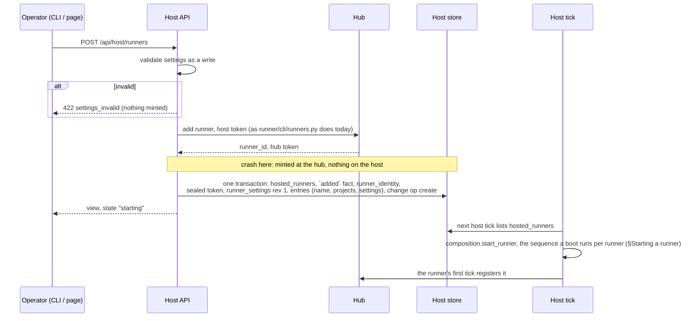

# Runners, workspaces, and subscriptions on a running host

Tables are [runner-store.md](./runner-store.md) §Data; the host tick's reconcile is [passes.md](./passes.md) §The host
tick; every route here takes `require_superuser` ([runner-api.md](./runner-api.md) §Who may write), except the workspace
prompt's, which keep the access they have.

## Domain

```mermaid
stateDiagram-v2
    direction LR
    state "Hosted runner" as R {
        [*] --> added: add, or seed of a [[runner]] with an id
        added --> retired: retire at the hub, or RetiredRunnerWatch
        retired --> [*]: final; the file cannot bring it back
    }
    state "Workspace or subscription" as W {
        [*] --> active: create, or seed
        active --> retired_w: retire
        retired_w --> active: enable
        note right of retired_w: never deleted; history stays
    }
```



- A hosted runner is the host's while its newest `hosted_runner_facts` row is `added`. Its id is hub-minted and
  `immutable`; everything else about it is its entries (`product:runner-id-fixed`).
- A workspace or subscription is a record in the shape `bzh:configured-record` gives the hub's: an `immutable` key
  (`workspace_id`; a subscription's `slug` and `provider`), a `revision` every write increments, a
  `host_setting_changes` row beside every write, sparse-merge edits, retirement as an appended fact, no delete
  (`product:host-records`).
- No write is gated on use: a workspace every runner binds can be retired, repointed, or moved to another provider, and
  a subscription every runner spends can be retired.

What each change does, taken up at the next host tick (`product:workspace-reshape`):

| Change                | Effect                                                                                                                                                                                                                                                                                                                   |
| --------------------- | ------------------------------------------------------------------------------------------------------------------------------------------------------------------------------------------------------------------------------------------------------------------------------------------------------------------------ |
| Create a workspace    | The host's from the next host tick; serves work once a runner binds a project to it                                                                                                                                                                                                                                      |
| Create a subscription | Sampled and reported from the next host tick                                                                                                                                                                                                                                                                             |
| Edit a workspace      | Provider, root, repositories, pool, limit, base branch, or prompt: a new provider; the next environment is acquired through it. A held environment stays held and is released or resumed through the workspace as it now stands. Blizzard does not reconcile the disk                                                    |
| Edit a subscription   | Name, credentials path, usage API base, or sample interval: sampler and renewer rebuilt. A running session keeps the credentials it launched with                                                                                                                                                                        |
| Retire a workspace    | Not reported. Each runner binding a project to it keeps its other bindings and claims nothing through it; the hub flags the binding unreported, as today; a chunk already claimed through it finishes there                                                                                                              |
| Retire a subscription | Not sampled or reported. A runner naming it declares none at registration from its next tick, is throttled by no subscription's usage, and is offered work as a runner paid for some other way. Its usage samples and usage-limit marks stay. Naming it again once enabled, or naming another, is the runner's own write |
| Enable either         | The retirement reversed                                                                                                                                                                                                                                                                                                  |

## Interfaces

### Runners

```http
POST /api/host/runners
{ "name": "night-1", "projects": [...], "settings": { "agents": 2 } }

→ the runner's view with "state": "starting"
422 settings_invalid       # `settings` validated as a write is, before the hub is asked: no mint at the hub
```

```http
POST /api/host/runners/{runner_id}/retire
{ "force": false }

→ the runner's view
# The hub's refusal while the runner holds a chunk, unless forced (execution/retirement.md), is the host's answer.
```

`GET /api/host/runners` lists the hosted runners.

| CLI                      | Host running     | Host stopped                                                                                             |
| ------------------------ | ---------------- | -------------------------------------------------------------------------------------------------------- |
| `blizzard runner add`    | The add route    | The same transaction against the store, holding the host's lock (`store_write_guard`); says which it did |
| `blizzard runner retire` | The retire route | As above; the host's next start takes the change up at its first tick                                    |

Neither verb edits `blizzard-host.toml` or `.env`. An operator who wants the file to hold a runner exports
([runner-api.md](./runner-api.md) §Apply).

### Workspaces and subscriptions

| Verb   | Route                                                                           | Notes                                          |
| ------ | ------------------------------------------------------------------------------- | ---------------------------------------------- |
| create | `POST /api/host/workspaces`, `POST /api/host/subscriptions`                     | Validated as the file is at boot               |
| list   | `GET` the same                                                                  | `?retired=true` includes retired records       |
| show   | `GET /api/host/workspaces/{workspace_id}`, `GET /api/host/subscriptions/{slug}` |                                                |
| edit   | `PATCH` the same, `If-Match`                                                    | Legal on a retired record, which stays retired |
| retire | `POST …/{key}/retire`                                                           | Of a retired record: writes nothing            |
| enable | `POST …/{key}/enable`                                                           | Of an enabled record: writes nothing           |

A create or edit is refused `422 settings_invalid` with each key's error for what the file would fail at boot: a
provider the host cannot build, a root that is not a path, a `max_environments` below one.

### The workspace prompt

`prompt`, `prompt_file`, and `prompt_package` are settings of the workspace record. The existing routes
(`runner/api/workspace_prompt.py`) stay and write the record through the same write as any edit:

| Route                                               | Writes                                                                                                |
| --------------------------------------------------- | ----------------------------------------------------------------------------------------------------- |
| `PUT /api/host/workspaces/{workspace_id}/prompt`    | `prompt` set; `prompt_file` and `prompt_package` to defaults, since a route-set prompt has always won |
| `DELETE /api/host/workspaces/{workspace_id}/prompt` | All three to defaults: no standing prompt, `source` answers `default`                                 |

Both keep the access they have today ([runner-api.md](./runner-api.md) §Who may write); only the record they write is
new. The `workspace_prompt` table is deprecated, read only by the seed ([runner-store.md](./runner-store.md) §Seeding),
and dropped later (`engineering:deprecations-outlive-epic`).

## Flows

### Adding a runner



- The add writes the `hosted_runners` row and the identity row in one transaction, so the next start finds the store the
  host's ([runner-store.md](./runner-store.md) §Which store is the host's).
- Nothing is written to `.env` or `blizzard-host.toml`, and no directory is created. The runners beside it keep ticking.
- A crash between the mint and the transaction leaves a runner the hub shows as never registered, with no row and no
  token on the host. Nothing runs under it; the operator retires it from the hub and adds again. The hub mints the id
  the rows are keyed by, so the two cannot share a transaction; `architecture/crash-correctness/runner.md` records the
  window under `bzh:crash-exemptions-runner`.

### Starting a runner

Today a boot prepares each runner inline in `runner/cli/runtime.py::host` before any runner ticks. Under this epic that
preparation is one function, `runner/composition.py::start_runner`. The boot calls it for each hosted runner, and the
host tick calls it for each one added since the last tick, so a runner added live is prepared exactly as one started at
boot:

1. Compose the runner's process graph (`composition.add_runner`) and its harness set ([passes.md](./passes.md) §The
   harness set), the bundle published as part of it.
2. Every per-runner startup step the boot runs today, in the boot's order: the session reconcile, the worker-scratch
   reconcile, the worker-shell refusal, the rejected-tracing announcement, `resume.on_startup()`, and takeover recovery.
3. A host report naming the runner before its first tick, so a runner the hub has released is told so before it can
   claim.
4. Its drivers started (tick, trace sweep, spawner), and the runner placed in `app.state.runners`.

A step that fails at boot fails the boot, as today. A step that fails during the host tick leaves the runner unstarted,
names the step and its error in the runner's view (`state: "start_failed"`), and is retried at the next host tick; its
neighbours keep ticking.

### Retiring a runner

```mermaid
sequenceDiagram
    participant Op as Operator
    participant H as Host API
    participant Hub
    participant S as Host store
    participant T as Host tick
    Op->>H: POST …/retire {force}
    H->>Hub: retire, host token
    alt holds a chunk and not forced
        Hub-->>H: refused
        H-->>Op: the hub's refusal
    end
    Hub-->>H: retired
    H->>S: `retired` fact
    T->>T: next tick drains this runner alone: stop its drivers, wait out its tick,<br/>resume.on_shutdown() (under force, stops its workers as ShutdownDrain does),<br/>RunnerProcess.close_runner, remove from app.state.runners
    T->>S: delete the sealed token; identity and settings rows stay
```

A runner the hub retires another way (the hub's CLI, or with its host) is noticed as today, when the hub refuses its
token. `RetiredRunnerWatch` (`runner/hub/identity_service.py`), which today deletes the identity row and leaves the
threads running, now writes the same `retired` fact, and the same tick drains it. One retired while its host was down is
noticed and drained at the host's first tick.
