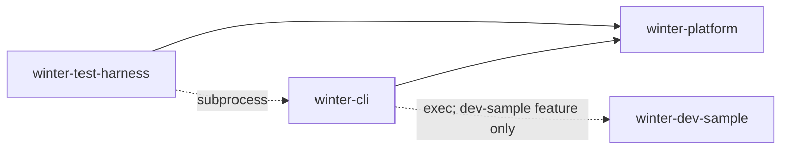

# Workspace and application boundaries

## System

```text
c5xlabs/winter/
├── Cargo.toml
├── Cargo.lock
├── rust-toolchain.toml
├── dev-tools.env
├── scripts/bootstrap-dev.sh
├── scripts/winter-cli         # development-only checkout entry point; never installs or shadows winter
├── .cargo/config.toml
├── .github/workflows/check.yml
├── dprint.json
├── .rumdl.toml
├── AGENTS.md
└── crates/
    ├── platform/       # winter-platform: public library facade, private implementation modules
    ├── cli/            # winter-cli: binary winter; no library target
    ├── test-harness/   # winter-test-harness: support library, winter-dev binary, integration tests
    └── dev-sample/     # winter-dev-sample: independent development executable
```



| Package               | Targets                                                              | Responsibilities                                                                       | Allowed workspace dependencies |
| --------------------- | -------------------------------------------------------------------- | -------------------------------------------------------------------------------------- | ------------------------------ |
| `winter-platform`     | Library                                                              | Parse/render facade, command behavior, feature-gated process replacement               | None                           |
| `winter-cli`          | `winter` binary                                                      | Read argv and selected environment, inject identity and process adapter, write replies | `winter-platform`              |
| `winter-test-harness` | Library, `winter-dev` binary, `component` and `service` test targets | Fixtures, bounded subprocess ownership, development/check orchestration                | `winter-platform`              |
| `winter-dev-sample`   | Binary                                                               | Observable process behavior; no launcher implementation                                | None                           |

```toml
# Cargo.toml — engineering:command-boundaries, engineering:reproducible-setup
[workspace]
members = ["crates/platform", "crates/cli", "crates/test-harness", "crates/dev-sample"]
default-members = ["crates/cli"]
resolver = "3"

[workspace.package]
version = "0.1.0"
edition = "2024"
rust-version = "1.99"

[workspace.dependencies]
winter-platform = { path = "crates/platform", default-features = false }
```

```toml
# rust-toolchain.toml
[toolchain]
channel = "1.99.1"
profile = "minimal"
components = ["rustfmt", "clippy"]
```

| Dependency            | Initial version constraint | Consumers                                                                                    |
| --------------------- | -------------------------- | -------------------------------------------------------------------------------------------- |
| `clap`                | `4.6.7`                    | Platform parser and development-driver parser                                                |
| `thiserror`           | `2.0.21`                   | Platform typed failures                                                                      |
| `cargo_metadata`      | `0.23.1`                   | Test harness artifact discovery and architecture checks                                      |
| `tempfile`            | `3.27.0`                   | Test harness isolated invocations                                                            |
| `serde`, `serde_json` | `1.0.229`, `1.0.154`       | Test harness and sample inspection records                                                   |
| `libc`                | `0.2.191`                  | Feature-gated platform `execve`, test harness process-group cleanup, and sample signal modes |
| `signal-hook`         | `0.4.6`                    | Development-driver cancellation and process-group cleanup                                    |

All four manifests inherit workspace version, edition, and rust-version. `Cargo.lock` owns exact resolutions; the
harness and sample declare `publish = false`.

```gitignore
target/
.tools/
```

```toml
# crates/platform/Cargo.toml
[features]
default = []
dev-sample = ["dep:libc"]

[dependencies]
libc = { version = "0.2.191", optional = true }
```

```toml
# crates/cli/Cargo.toml and crates/test-harness/Cargo.toml
[features]
default = []
dev-sample = ["winter-platform/dev-sample"]
```

| Configuration | Platform feature | CLI feature  | Harness feature | Sample executable                          |
| ------------- | ---------------- | ------------ | --------------- | ------------------------------------------ |
| `production`  | Disabled         | Disabled     | Disabled        | Not required; may exist as an unused decoy |
| `development` | `dev-sample`     | `dev-sample` | `dev-sample`    | Built independently                        |

Production and development use separate Cargo invocations and target directories; a workspace-wide `--all-features`
invocation cannot establish production isolation. Only feature-enabled request handling reads the sample-path variable.

## Domain

```text
winter-platform/src/
  lib.rs       # public facade; re-exports the interfaces specified by cli.md and sample.md
  cli.rs       # private: clap setup, control requests, usage errors, response rendering
  sample.rs    # private, cfg(dev-sample): argument/path validation and replacement orchestration
  process.rs   # private, cfg(dev-sample): Process seam and UnixProcess implementation

winter-cli/src/main.rs
  argv_os -> platform parser -> control reply OR feature-gated sample invocation
  CliIdentity.version = env!("CARGO_PKG_VERSION") from winter-cli, never from winter-platform
  only main owns process stdout/stderr writes for launcher replies and normal process exit
```

The executable passes its package metadata into the library; library metadata, `argv[0]`, and working-directory contents
are not executable identity sources. Command behavior returns values or typed errors and never constructs a parser,
reads global configuration, or writes process streams.

## Interfaces

```rust
// engineering:command-boundaries; checker lives in winter-test-harness, not another workspace crate.
struct DependencyViolation {
    from_package: String,
    to_package: String,
    dependency_kind: DependencyKind, // normal | dev | build
    target_condition: Option<String>,
    dependency_alias: Option<String>,
}

fn check_workspace_boundaries(metadata: &cargo_metadata::Metadata) -> Result<(), Vec<DependencyViolation>>;
```

| Input                                                            | Check                                                                            |
| ---------------------------------------------------------------- | -------------------------------------------------------------------------------- |
| `cargo metadata --format-version 1 --no-deps --locked --offline` | Exactly the four declared members; every declared dependency inspected           |
| Workspace path dependencies                                      | Identify by canonical package path, including renamed dependencies               |
| Optional, dev, build, and target-specific dependencies           | Apply the same allowlist even when inactive on the host                          |
| Forbidden edge or cycle                                          | Fail with source package, destination package, kind, and target condition        |
| Private platform implementation modules                          | Rust visibility rejects imports from other packages; facade exports are explicit |

Checker self-tests feed altered metadata containing forbidden normal, optional, renamed, build, dev, and target-specific
edges. Package/API boundaries are the automated enforcement unit; no Rust source scanner or unrestricted public module
tree is introduced.
