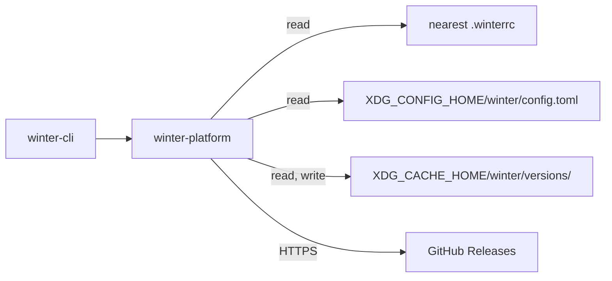

# Winter component install spec

## System



| Role        | Executable         | Release repository         |
| ----------- | ------------------ | -------------------------- |
| `workspace` | `winter-workspace` | `c5xlabs/winter-workspace` |
| `hub`       | `winter-hub`       | `c5xlabs/winter-fleet`     |
| `runner`    | `winter-runner`    | `c5xlabs/winter-fleet`     |

The table is compiled into `winter` (`decision:component-install/release-source`). The Fleet hub and runner services are
never installation targets.

| External dependency        | Use                                           | Limits the design relies on                                      |
| -------------------------- | --------------------------------------------- | ---------------------------------------------------------------- |
| GitHub Release asset links | Archive and `.sha256` download                | Redirects to a CDN; connect 10 s, stall 30 s                     |
| GitHub REST API            | Tell an unknown version from a missing target | 60 requests/hour per IP unauthenticated; only after an asset 404 |
| Host filesystem            | Cache entries, staging, locks                 | `rename(2)` atomic within one filesystem                         |

| Module (`winter-platform/src/`) | Change                                                                              |
| ------------------------------- | ----------------------------------------------------------------------------------- |
| `install.rs`                    | New: `winter install`, argument forms, per-release outcome lines                    |
| `cache.rs`                      | New: entry paths, lock, staging, atomic publish                                     |
| `release_source.rs`             | New: `ReleaseSource` trait and its GitHub implementation                            |
| `selection.rs`                  | Unchanged; `resolve` supplies the no-argument form (`engineering:shared-selection`) |
| `dispatch.rs`                   | `NotCached` diagnostic gains the `winter install <role> <version>` line             |
| `cli.rs`                        | Registers `install` as a platform command, not a dispatch group                     |

`winter-cli/src/main.rs` injects these with the launcher shim's inputs; install code never calls `std::env` itself.

| Input                         | Default                  | Use                                                                                          |
| ----------------------------- | ------------------------ | -------------------------------------------------------------------------------------------- |
| `WINTER_RELEASE_DOWNLOAD_URL` | `https://github.com`     | Base for archives and checksums; fixtures and mirrors                                        |
| `WINTER_RELEASE_API_URL`      | `https://api.github.com` | Base for the release lookup; fixtures and mirrors                                            |
| `GITHUB_TOKEN`                | unset                    | Sent on lookups to `https://api.github.com` only; never to an overridden URL or on downloads |

## Domain

```rust
// Role, Version, Selection, DispatchEnv: the launcher shim's spec.

pub struct Release {
    pub role: Role,
    pub version: Version,     // exact; validated before any path join or URL
    pub target: &'static str, // winter's own compile-time target triple
}

pub trait ReleaseSource {
    fn checksum(&self, release: &Release) -> Result<[u8; 32], SourceError>;
    fn download(&self, release: &Release, into: &mut dyn std::io::Write) -> Result<(), SourceError>;
}

pub enum Bound { Connect, Stall } // engineering:download-bounds

pub enum SourceError {
    UnknownVersion,                                   // no release with this version
    NotPublishedForTarget,                            // release exists, no archive for this target
    Network { url: String, bound: Option<Bound>, cause: std::io::Error },
    MalformedChecksum { url: String },
}

pub enum InstallOutcome { Fetched, AlreadyPresent }

pub enum InstallError {
    Source { release: Release, cause: SourceError },
    ChecksumMismatch { release: Release, url: String },
    Extract { release: Release, cause: std::io::Error },
    LockTimeout { release: Release, lock: PathBuf },
}

pub fn install(release: &Release, env: &DispatchEnv, source: &dyn ReleaseSource)
    -> Result<InstallOutcome, InstallError>;
```

## Interfaces

```text
winter install <role> <version>      # product:install-component-version
winter install                       # product:install-selected-versions
```

| Invocation                              | stdout                             | stderr                               | Exit |
| --------------------------------------- | ---------------------------------- | ------------------------------------ | ---- |
| Named release fetched or already cached | One outcome line                   | Empty                                | `0`  |
| Named release fails                     | One outcome line                   | Release, source URL, and failed step | `1`  |
| No argument, every selection satisfied  | One outcome line per selected role | Empty                                | `0`  |
| No argument, any fetch fails            | One outcome line per selected role | One diagnostic per failed release    | `1`  |
| No argument, no role has a selection    | Empty                              | The files searched                   | `1`  |
| Unknown role or malformed version       | Empty                              | Usage error                          | `2`  |

```text
outcome lines (stdout), role order workspace, hub, runner:
  workspace 1.4.0 fetched
  hub 2.0.0 already present
  runner 1.9.2 failed

diagnostics (stderr):
  winter: cannot install runner 1.9.2: no release 1.9.2 in c5xlabs/winter-fleet
  winter: cannot install runner 1.9.2: release has no archive for aarch64-apple-darwin
  winter: cannot install runner 1.9.2: no bytes for 30 s from <url>
  winter: cannot install runner 1.9.2: checksum mismatch for <url>

dispatch NotCached (launcher shim), with the added line:
  winter: cannot run runner: 1.9.2 is not in the version cache at <dir>
  winter: run `winter install runner 1.9.2`
```

The no-argument form skips a role with no selection and keeps going after a failed release. A role whose selection file
fails to parse counts as failed, with the launcher's `InvalidConfig` diagnostic. No form writes `.winterrc` or the user
`config.toml`.

### Release source

```text
archive:  GET {download}/{owner}/{repo}/releases/download/v{version}/{executable}-{target}.tar.xz
checksum: GET {download}/{owner}/{repo}/releases/download/v{version}/{executable}-{target}.tar.xz.sha256
          -> first 64 hex characters of the body; anything else is MalformedChecksum
on 404 from either:
          GET {api}/repos/{owner}/{repo}/releases/tags/v{version}
          Authorization: Bearer $GITHUB_TOKEN    # only when set, and only to the default API URL
          -> 401 with a token: retry once without it
          -> 404 -> UnknownVersion
          -> 200 -> NotPublishedForTarget
```

The asset names are `cargo-dist`'s defaults (`decision:release-automation/release-automation`).

## Flows

```text
install(release)
  -> entry <cache>/<role>/<version>/<target>/component.toml exists? -> AlreadyPresent, no network
  -> open + flock(LOCK_EX) <cache>/<role>/<version>/<target>.lock, waiting up to 300 s
       timeout -> LockTimeout
  -> entry appeared while waiting? -> unlock, AlreadyPresent
  -> mkdir <cache>/<role>/<version>/.staging-<target>-<pid>
  -> fetch checksum; stream archive to staging while hashing
  -> hash != checksum -> ChecksumMismatch
  -> extract into staging/entry
  -> staging/entry/component.toml passes the launcher's manifest validation?   # decision:component-install/component-manifest
       no -> Extract
  -> fsync
  -> rename(staging/entry, <cache>/<role>/<version>/<target>)   # the only publish step
  -> remove staging, unlock -> Fetched
  any failure or SIGINT/SIGTERM -> remove staging, unlock, no entry
```

The lock is an advisory `flock` released by the kernel when its holder dies, so a killed installer never blocks the next
one. Staging directories left by a `SIGKILL` are named by PID and removed by the next fetch of that release.

```text
winter install                   (cwd = /home/me/ws/alpha/repo)
  -> for role in [workspace, hub, runner]:
       resolve(role)             # launcher shim; engineering:shared-selection
         NoSelection   -> skip
         InvalidConfig -> "<role> failed", continue
         Selection     -> install(release)
                            Ok(Fetched | AlreadyPresent) -> outcome line
                            Err                          -> "<role> <version> failed", diagnostic, continue
  -> exit 1 if any role failed or none had a selection, else 0
```

## Data

```text
$XDG_CACHE_HOME/winter/versions/            # decision:version-cache
  workspace/
    1.4.0/
      x86_64-unknown-linux-gnu/             # entry: immutable once renamed into place
        component.toml
        bin/winter-workspace
      x86_64-unknown-linux-gnu.lock
      .staging-x86_64-unknown-linux-gnu-48213/   # present only during a fetch
  runner/
    1.9.2/
      x86_64-unknown-linux-gnu/
        component.toml
        bin/winter-runner
```

No garbage collection: entries stay until the person deletes them, and deleting an entry only means fetching it again.

## Open questions

- Does `c5xlabs/winter-fleet` publish `winter-hub` and `winter-runner` under one `v<version>` tag, as one release unit
  under `decision:release-versioning`, or under per-executable tags? The release-source lookup above assumes one tag per
  repository. Fleet engineering and release automation can answer.
