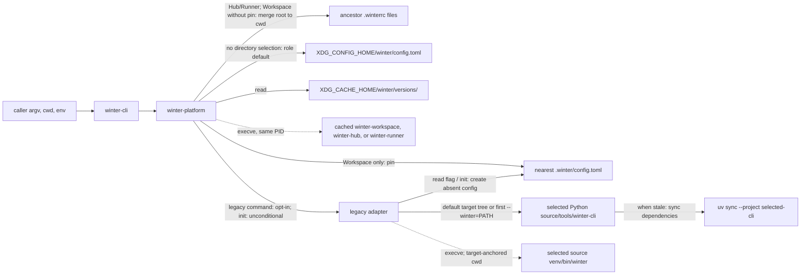

# Winter launcher shim spec

## System



| Module (`winter-platform/src/`) | Change                                                                                            |
| ------------------------------- | ------------------------------------------------------------------------------------------------- |
| `process.rs`                    | Loses its `cfg(dev-sample)` gate; `Process` and `UnixProcess` serve production dispatch           |
| `dispatch.rs`                   | New: modern version resolution, manifest validation, `ExecRequest` construction                   |
| `selection.rs`                  | New: ancestor `.winterrc` merge, Workspace pin discovery, version-string validation               |
| `legacy.rs`                     | New: target/source selection, venv leases/preparation, temporary init; injected effects           |
| `cli.rs`                        | Classifies modern groups, legacy command names, init, and platform controls without parsing tails |
| `sample.rs`                     | Uses extended `ExecRequest` with inherited cwd; keeps dev-only path and handoff behavior          |

`winter-cli/src/main.rs` injects the environment values below; dispatch code never calls `std::env` itself.

| Input                 | Source                                      | Default when unset or empty                                  |
| --------------------- | ------------------------------------------- | ------------------------------------------------------------ |
| `cwd`                 | `std::env::current_dir()`                   | Required; failure exits 126                                  |
| `HOME`                | `var_os("HOME")`                            | Required for an unset XDG directory; failure exits 126       |
| `XDG_CONFIG_HOME`     | `var_os("XDG_CONFIG_HOME")`, absolute only  | `$HOME/.config`                                              |
| `XDG_CACHE_HOME`      | `var_os("XDG_CACHE_HOME")`, absolute only   | `$HOME/.cache`                                               |
| Host target           | Build-time `TARGET`, exported by `build.rs` | Compiled in                                                  |
| Inherited environment | One `vars_os()` snapshot per dispatch       | Modern `DispatchEnv.inherited`; legacy `LegacyEnv.inherited` |
| Launch instant        | Wall-clock timestamp at launcher entry      | Decimal epoch seconds for legacy `WINTER_LAUNCH_TIME`        |

Relative XDG values are ignored, per the XDG base-directory specification. Legacy dispatch does not require XDG
directories, Rust version selections, or the cache. Platform help/version require none of these inputs. Tests isolate
the environment, synchronizer, cache, and complete ancestor filesystem (`engineering:fixture-only-dispatch`).

## Domain

```rust
use std::{ffi::OsString, path::PathBuf};

pub enum Role {
    Workspace, // group "workspace", executable "winter-workspace"
    Hub,       // group "hub",       executable "winter-hub"
    Runner,    // group "runner",    executable "winter-runner"
}

/// Exact release version, e.g. "1.4.0" or "2.0.0-rc.1". No ranges, aliases, or "latest".
/// Grammar: MAJOR.MINOR.PATCH[-PRERELEASE] with numeric parts lacking leading zeros and PRERELEASE in
/// [0-9A-Za-z.-]. Validation precedes any path join, so a version can never contain "/" or "..".
pub struct Version(String);

pub enum SelectionSource {
    Pin { file: PathBuf },       // nearest .winter/config.toml; Role::Workspace only
    Directory { file: PathBuf }, // .winterrc that supplied this role's winning value
    UserDefault { file: PathBuf },
}

pub struct Selection {
    pub role: Role,
    pub version: Version,
    pub source: SelectionSource, // carried into every dispatch diagnostic
}

pub struct DispatchRequest {
    pub role: Role,
    pub args: Vec<OsString>, // every token after the group, unchanged
}

pub struct DispatchEnv {
    pub cwd: PathBuf,
    pub config_home: PathBuf,
    pub cache_home: PathBuf,
    pub target: &'static str,
    pub inherited: Vec<(OsString, OsString)>, // captured by main; preserve native keys/values
}

pub struct LegacyRequest {
    pub args: Vec<OsString>, // original tail minus optional first --winter=PATH; Python options stay unchanged
    pub source_override: Option<PathBuf>, // native caller-supplied path; resolve relative to original cwd
    pub init_index: Option<usize>, // index in args; None = flag-gated command; Some = temporary init token
}

pub struct LegacyEnv {
    pub cwd: PathBuf,
    pub inherited: Vec<(OsString, OsString)>,
    pub launch_time: OsString, // launcher-entry epoch seconds, not an inherited timestamp
}

pub enum Route {
    Modern(DispatchRequest),
    Legacy(LegacyRequest),
    // Foundation retains platform help, version, usage errors, and gated sample dispatch.
}

// Production extension; modern/sample use cwd=None, inherited_fds=[], and their own environment policies.
pub struct ExecRequest {
    pub executable: PathBuf,
    pub args: Vec<OsString>,
    pub cwd: Option<PathBuf>, // None = inherited; legacy = workspace/tools/winter-cli
    pub env: Vec<(OsString, OsString)>, // explicit inherited snapshot plus route-specific changes
    pub inherited_fds: Vec<std::os::fd::OwnedFd>, // legacy shared lease only; retained across successful exec
}
```

```text
selection order (decision:launcher-shim/version-scope)
  Workspace: nearest .winter/config.toml versions.workspace
               -> inherited .winterrc versions.workspace -> user default versions.workspace -> NoSelection
  Hub:       inherited .winterrc versions.hub             -> user default versions.hub       -> NoSelection
  Runner:    inherited .winterrc versions.runner          -> user default versions.runner    -> NoSelection

inherited .winterrc selection:
  enumerate cwd and every parent through filesystem root, inclusive
  read existing .winterrc files in root-to-cwd order
  merge recognized versions keys independently; each child value replaces that role's value and source file
  absent key/table -> leave inherited values unchanged; no file terminates the walk
  parse error / invalid version / lookup or read error other than not-found -> InvalidConfig
  validate every file, including values later overridden by a child
  HOME is not an ancestor-discovery input; ~/.winterrc participates only if it is an ancestor
  requested role absent after merge -> consult that role's user-selected default

user-selected default:
  read $XDG_CONFIG_HOME/winter/config.toml only when no applicable pin or directory selection exists
  versions.<role> present -> UserDefault; exact version, independent per role
  file/key absent -> NoSelection; include directory candidates and user file in searched paths
  lookup/read/parse error other than not-found / invalid recognized version -> InvalidConfig
  never infer a default from cache contents, PATH, or the platform executable's version
  selected release absent from cache -> NotCached, not a retry with a lower-precedence selection

Workspace pin:
  find nearest .winter/config.toml from cwd through root; stop at that file
  read only versions.workspace, not Workspace's full configuration model
  missing key -> inherited .winterrc selection, not an outer workspace's config
  parse error / invalid pin / lookup or read error other than not-found -> InvalidConfig
  valid pin -> select it without reading .winterrc
  Hub and Runner never discover or read .winter/config.toml
```

```text
# decision:singleton-launcher-succession
LEGACY_COMMANDS = {
  agents, capabilities, clean, dashboard, doctor, env, ext,
  graph, lint, provision, repo, service, space, ws
}

legacy discovery:
  find nearest .winter/config.toml from cwd through filesystem root; no outer-workspace fallback
  top-level enable-legacy-winter missing/false -> legacy disabled; true -> allow Python launch
  malformed TOML / non-boolean flag / lookup or read error other than not-found -> InvalidConfig
  require tools/winter-cli/ in that workspace; missing -> legacy failure, never run Rust instead
  no Rust version selection, cache manifest, XDG config, or user default is consulted

legacy implementation selection:
  target workspace and legacy permission always come from original cwd, never the override tree
  no override -> selected-cli = target/tools/winter-cli
  first --winter=PATH -> resolve PATH from original cwd, canonicalize directory, require PATH/tools/winter-cli/
                        selected-cli = resolved PATH/tools/winter-cli
  never discover or read override-source .winter/config.toml for target selection or permission
  canonicalize selected-cli and validate its project/entry module before setup or bootstrap writes
  missing/unreadable/malformed/wrong-project source -> InvalidSource; no fallback
  selected-cli owns Python code, dependency inputs, venv, and stamp; target/tools/winter-cli remains process cwd

temporary init:
  require cwd/tools/winter-cli/; do not walk ancestors; do not read or require legacy flag
  create cwd/.winter/config.toml as an empty file only if absent; never truncate/replace existing content
  do not add enable-legacy-winter; subsequent ordinary legacy commands still require explicit opt-in
  optional first --winter=PATH selects only its Python implementation, not its bootstrap destination
  only leading platform-position init selects bootstrap; an opaque Python option value cannot activate it
  validate selected source, then replace the init token with ws init; retain all non-launcher arguments in place
```

## Interfaces

```text
winter workspace [ARG...]
winter hub [ARG...]
winter runner [ARG...]
winter [PYTHON-OPTION/ARG...] <LEGACY_COMMAND> [ARG...]
winter --winter=PATH [PYTHON-OPTION/ARG...] <LEGACY_COMMAND> [ARG...]
winter init [ARG...]                 # temporary legacy bootstrap; no flag required
winter --winter=PATH init [ARG...]   # bootstrap cwd using selected Python implementation
winter --verbose|-v <GROUP> [ARG...]  # launcher diagnostics; legacy argv also reaches Python
```

```text
# Routing compares exact native OsStr tokens, not lossy strings or normalized clap values.
before classification, recognize optional FIRST argument --winter=PATH:
  retain PATH as native path bytes and remove only that launcher-control token from the routing/forwarded argv
  --winter without "=" or --winter= with empty PATH -> usage error, exit 2; do not consume the next argument
  do not resolve PATH yet; it cannot change routing, target discovery, or the legacy-enable flag

leading platform position (decision:launcher-shim/routing-boundary):
  skip leading exact --verbose/-v tokens for classification only; retain their positions in legacy argv
  no remaining token + no source override -> foundation Help, exit 0 (including bare winter and verbosity only)
  no remaining token + source override    -> usage error, exit 2; no path lookup
  inspect only the next token:
    workspace | hub | runner -> modern route; reject launcher --winter override before path lookup
    init                     -> unconditional bootstrap; remaining argv changes only by init -> ws init
    --help | -h | --version | -V -> foundation controls; no cwd/config/cache/source lookup
    sample                   -> existing sample adapter in development; unsupported in production
    registered platform command -> foundation owns its route; never forward it to Python
    LEGACY_COMMANDS          -> flag-gated legacy route
    unrecognized non-option -> foundation usage error, exit 2
    other option / --       -> opaque Python prefix; use the legacy-only scan below

legacy-only scan:
  scan remaining tokens left-to-right for an exact member of LEGACY_COMMANDS
  match -> flag-gated Python route; forward original argv except consumed first --winter=PATH
  no match -> foundation root parser handles inspection-only flag combinations or returns usage error, exit 2
  never recognize modern groups, init, sample, or platform controls inside this opaque prefix
  no option allowlist, option-arity tracking, or value parsing; Python validates the entire forwarded vector
  a legacy-name match inside an option value is harmless: it selects the same gated route without rewriting argv

stop classification when a route is selected; never inspect or reclassify that application's tail
foundation root parsing retains its help/version aliases and standard clap flag/control handling
non-first --winter tokens are not launcher controls; they remain in the selected application's argv
an override with a non-legacy platform command other than help/version -> usage error, exit 2; no path lookup
modern argv = unchanged tokens AFTER the group; root verbosity controls launcher stderr only
legacy argv = original tail minus first --winter=PATH, including root verbosity and Python-owned options
platform help lists modern groups, opt-in legacy routing, Python-only first --winter=PATH, init, and verbosity
component help/version after a routing token belongs to that application, not the launcher
```

| Invocation                                                                                    | Route                                                                             |
| --------------------------------------------------------------------------------------------- | --------------------------------------------------------------------------------- |
| `winter workspace ws init`                                                                    | Rust Workspace, argv `ws init`; legacy flag ignored                               |
| `winter --verbose hub --help`                                                                 | Rust Hub, argv `--help`; launcher verbosity on stderr                             |
| `winter ws init`                                                                              | Python, original argv `ws init`; legacy flag required                             |
| `winter --winter=./alpha/winter service status alpha`                                         | Selected Python source; argv `service status alpha`; original target and its flag |
| `winter --winter=./alpha/winter --service-orchestrator=./alpha/provider service status alpha` | Selected Python source; provider option and remaining argv unchanged              |
| `winter --service-orchestrator ./alpha/provider service status alpha`                         | Python, entire original argv; no option parsing                                   |
| `winter --service-orchestrator init service status alpha`                                     | Flag-gated Python, argv unchanged; never bootstrap                                |
| `winter --service-orchestrator hub service status alpha`                                      | Flag-gated Python, argv unchanged; never Rust Hub                                 |
| `winter service --unknown-option runner`                                                      | Python; `runner` is not reclassified as a modern group                            |
| `winter init --json`                                                                          | Temporary Python bootstrap, argv `ws init --json`; no flag/default required       |
| `winter --winter=./alpha/winter init --json`                                                  | Bootstrap original cwd with selected Python, argv `ws init --json`                |
| `winter --winter=./alpha/winter workspace ws init`                                            | Usage error, exit 2; no Python/Rust launch or source lookup                       |
| `winter` / `winter --verbose`                                                                 | Identical successful platform help; no cwd or configuration lookup                |
| `winter -V` / `winter --verbose --version`                                                    | Platform version; no cwd or configuration lookup                                  |
| `winter --help`                                                                               | Platform help; no workspace, Python, default, or cache lookup                     |

```rust
pub enum DispatchError {
    NoSelection { role: Role, searched: Vec<PathBuf> },                // 127
    InvalidConfig { file: PathBuf, reason: String },                   // 126
    NotCached { selection: Selection, dir: PathBuf },                  // 127
    InvalidManifest { selection: Selection, file: PathBuf, reason: String }, // 126
    IncompatibleHandoff { selection: Selection, handoff: u32 },        // 126
    Replacement { selection: Selection, executable: PathBuf, source: std::io::Error }, // 126
}

pub fn resolve(role: Role, env: &DispatchEnv) -> Result<Selection, DispatchError>;
pub fn prepare(selection: &Selection, req: DispatchRequest, env: &DispatchEnv) -> Result<ExecRequest, DispatchError>;
pub fn run_dispatch(req: DispatchRequest, env: &DispatchEnv, process: &mut dyn Process)
    -> Result<std::convert::Infallible, DispatchError>;
pub fn dispatch_failure_reply(error: DispatchError) -> Reply;

pub enum LegacyError {
    NoWorkspace,                                      // 1
    Disabled { file: PathBuf },                        // 2; show flag and explicit modern entry point
    MissingCli { dir: PathBuf },                       // 1
    InvalidSource { path: PathBuf, reason: String },    // 1; selected Python source, no fallback
    InvalidConfig { file: PathBuf, reason: String },    // 126
    Setup { path: PathBuf, source: std::io::Error },    // 126; includes bootstrap/venv/stamp effects
    Busy { venv: PathBuf },                            // 1; in use or changed during setup; retry when idle
    Sync { executable: PathBuf, status: std::process::ExitStatus }, // propagate nonzero status/signal
    Replacement { executable: PathBuf, source: std::io::Error },    // ENOENT=127; other errors=126
}

pub trait LegacySetup {
    // Implements the legacy/init flow below through injected filesystem and synchronizer adapters.
    fn prepare(&mut self, req: LegacyRequest, env: &LegacyEnv) -> Result<ExecRequest, LegacyError>;
}

// Main injects the inherited environment and launch instant; adapters own filesystem and uv effects.
pub fn run_legacy(req: LegacyRequest, env: &LegacyEnv, setup: &mut dyn LegacySetup, process: &mut dyn Process)
    -> Result<std::convert::Infallible, LegacyError>;
```

| Outcome                    | stdout      | stderr                                                                       | Exit                         |
| -------------------------- | ----------- | ---------------------------------------------------------------------------- | ---------------------------- |
| Replacement succeeds       | Component's | Component's                                                                  | Component's status or signal |
| `NoSelection`, `NotCached` | Empty       | `winter: cannot run <role>: …`, the files searched or the expected directory | 127                          |
| `InvalidConfig`            | Empty       | `winter: cannot run <role>: …`, the invalid file and reason                  | 126                          |
| Any other `DispatchError`  | Empty       | `winter: cannot run <role> <version> (from <source file>): …`                | 126                          |

Every dispatch diagnostic starts with `winter: cannot run`; legacy failures use `winter: cannot run legacy workspace`
with the relevant workspace/path and cause, not a fabricated Rust version. Modern dispatch never retries another
version, searches PATH, or writes files (`product:explain-dispatch-failure`). Legacy setup may locate `uv` on inherited
PATH, synchronize its selected source and dependency environment, publish its sync stamp, and perform temporary init,
but never searches PATH for a product. `Busy` names the venv and advises retrying after the active command/setup
finishes; it never falls back, waits indefinitely, or changes an environment/stamp without exclusive ownership.

| Handoff field  | Contract                                                                                            |
| -------------- | --------------------------------------------------------------------------------------------------- |
| Executable     | `<cache>/winter/versions/<role>/<version>/<target>/<manifest.executable>`, direct `execve`, no PATH |
| `argv[0]`      | The selected executable path                                                                        |
| Arguments      | Every token after the group, unchanged `OsString` values                                            |
| cwd, fds 0/1/2 | Inherited unchanged                                                                                 |
| Environment    | Copy `DispatchEnv.inherited`; replace only `WINTER_INVOKED_AS` with `winter <group>`                |
| Process        | Same PID via `execve`; the component owns exit status and signals (`product:preserve-invocation`)   |

```text
# component side of the handoff, handoff = 1 (product:invocation-aware-help)
WINTER_INVOKED_AS set and nonempty -> use it as the usage prefix in help, nested help, and usage errors
WINTER_INVOKED_AS unset or empty   -> use the component's own executable name
read once at startup, then removed from the component's environment so child processes never inherit it
never affects component identity, --version output, or behavior other than displayed prefixes
```

The shim supports handoff version `1` only. A later handoff version adds to this table and keeps accepting `1`.

| Legacy handoff field       | Contract                                                                                                 |
| -------------------------- | -------------------------------------------------------------------------------------------------------- |
| Executable                 | Absolute `<resolved venv>/bin/winter`; direct `execve`, never the old Bash wrapper or `winter` from PATH |
| Arguments                  | Original legacy argv minus first `--winter=PATH`; temporary init also rewrites its token to `ws init`    |
| cwd                        | `<workspace>/tools/winter-cli`, retaining the Python GitPython layout workaround                         |
| Invocation directory       | `WINTER_INVOCATION_CWD` replaced with original caller cwd before any chdir                               |
| Python environment         | Remove `PYTHONHOME`; set `VIRTUAL_ENV`; prepend venv `bin` to inherited `PATH`                           |
| Launch timing              | Replace `WINTER_LAUNCH_TIME` with launcher-entry epoch seconds for Python's existing tracing reader      |
| Invocation metadata        | Remove inherited `WINTER_INVOKED_AS`; legacy Python keeps its existing `winter` usage prefix             |
| Streams and process        | Inherit fds 0/1/2; same PID after exec; Python owns exit status and signals                              |
| Synchronizer               | `uv sync --project <absolute selected-cli>`, no shell, cwd = target/tools/winter-cli, output on stderr   |
| Synchronizer environment   | Setup environment with `UV_PROJECT_ENVIRONMENT` set to the resolved absolute venv                        |
| Venv ownership             | Shared lease retained across Python exec; exclusive lease required for synchronization                   |
| Setup failure/cancellation | Do not exec Python; preserve failure status or interruption and terminate/reap setup children            |

## Flows

```text
args_os + launcher-entry instant -> classify routing token
  platform control -> foundation reply/adapter; help/version need no cwd or config
  legacy/init      -> capture cwd and environment snapshot -> run_legacy (flow below)
  modern group     -> capture cwd, environment snapshot, and XDG directories
       -> DispatchEnv { cwd, config_home, cache_home, target, inherited = captured vars_os snapshot }
       -> DispatchRequest { role, args = unchanged tokens after group }
      -> resolve(role)
            Workspace only: walk cwd, parent, ... "/" for nearest .winter/config.toml
                         lookup/read/parse error or bad pin -> InvalidConfig
                         found + versions.workspace         -> Pin; skip .winterrc
                         found without key / no file         -> resolve inherited .winterrc
            inherited .winterrc:
                         enumerate ancestor paths through "/" inclusive
                         read and validate root to cwd; missing files are skipped
                         lookup/read/parse error or bad version -> InvalidConfig
                         each versions key replaces only its role's value and source
                         requested role present                -> Directory { file: winning source }
                         requested role absent                 -> user config versions.<role>
                             file/key missing                  -> NoSelection (all searched paths listed)
                             malformed/unreadable/bad version  -> InvalidConfig
                             key present                       -> UserDefault
      -> prepare
           dir = cache/winter/versions/<role>/<version>/<target>/
           dir/component.toml missing                  -> NotCached
           parse error, role/version/target mismatch   -> InvalidManifest
           handoff not in {1}                          -> IncompatibleHandoff
           executable relative path escapes dir        -> InvalidManifest
            -> ExecRequest { executable, args, cwd: None, inherited_fds: [],
                             env: copy env.inherited, replacing WINTER_INVOKED_AS only }
      -> Process.replace
           error -> Replacement -> dispatch_failure_reply -> exit 126
           ok    -> component owns the process
```

No preflight checks the executable's existence or mode; `execve` reports `ENOENT` and `EACCES` as `Replacement`, which
avoids a check-then-exec race. `.winterrc` discovery never stops at the first file; a lookup or read error other than
not-found, such as an unreadable ancestor, is `InvalidConfig`, not permission to skip that ancestor.

```text
legacy/init:
  init -> cwd/tools/winter-cli exists?
            no  -> MissingCli; no ancestor discovery or config mutation
            yes -> target = cwd; defer config creation until source validation succeeds
  other legacy command -> discover nearest config; require enable-legacy-winter = true
                          target = config parent directory's parent; require target/tools/winter-cli
  target-cli = target/tools/winter-cli
  selected-cli = target-cli unless source_override is present:
      resolve override relative to ORIGINAL cwd, canonicalize directory, require its tools/winter-cli/
      error -> InvalidSource with supplied path and reason; do not retry target-cli or write config
      success -> selected-cli = resolved override/tools/winter-cli
  canonicalize selected-cli; failure -> InvalidSource
  validate selected-cli BEFORE config creation, stamp changes, or uv:
      pyproject.toml must be a readable regular file and valid TOML, with:
          project.name = "winter-cli"
          project.scripts.winter = "winter_cli.cli:cli"
      src/winter_cli/cli.py must be a readable regular file
      failure -> InvalidSource with offending path/reason; no fallback, bootstrap write, or synchronization
      validation does not import Python or prove dependencies load; installation/runtime failures remain separate
  setup_env = inherited snapshot with original WINTER_INVOCATION_CWD and launcher-entry WINTER_LAUNCH_TIME,
              removing inherited WINTER_INVOKED_AS
  venv = inherited UV_PROJECT_ENVIRONMENT when nonempty, otherwise selected-cli/.venv
         relative venv paths resolve against selected-cli, not target-cli or original cwd
         resolve symlinks in the longest existing ancestor, then append any missing path suffix
         use this absolute physical destination for the lease, stamp, uv environment, and Python entrypoint
  lease-file = native venv path with ".winter-launch.lock" appended (a stable sibling, not inside the venv)
  create missing venv parent directories; open/create lease-file without truncation; never unlink it
  acquire shared lease with flock(LOCK_SH | LOCK_NB); contention -> Busy, other I/O errors -> Setup
  stamp = venv/.winter-sync-stamp
  source-id = native bytes of canonical selected-cli
  stale = entrypoint not executable OR stamp missing/malformed/old-format OR stamp source-id differs OR any existing
          selected-cli/{uv.lock,pyproject.toml,.python-version} has mtime newer than stamp
          stamp read/stat errors other than not-found -> Setup; do not treat an I/O failure as warm
  stale?
    no  -> do not locate or run uv
    yes -> release shared lease; acquire exclusive with flock(LOCK_EX | LOCK_NB)
           contention -> Busy; no environment/stamp mutation
           reread freshness under exclusive ownership; another launch may already have synchronized this source
           if now warm -> skip synchronization
           otherwise:
             resolve uv on inherited PATH; invalidate old stamp BEFORE uv can mutate the venv
             invalidation failure -> Setup; do not run uv or Python
             sync_env = setup_env with UV_PROJECT_ENVIRONMENT = absolute resolved venv
             run uv sync --project selected-cli in sync_env, cwd = target-cli, stdout/stderr on stderr
             do not add --locked/--frozen; honor inherited uv configuration:
                 uv may update selected-source uv.lock, install/build dependencies, use its caches,
                 and download managed Python according to inherited uv configuration
             fail/cancel -> stamp stays absent, no Python launch; report failed setup
             success     -> atomically publish source-aware stamp with completion mtime
                            stamp publication failure -> Setup; no Python launch or valid success marker
                            remove any unpublished temporary stamp on failure
           release exclusive lease; acquire shared with flock(LOCK_SH | LOCK_NB)
           contention -> Busy; recheck freshness under shared ownership
           changed source/stamp/inputs -> Busy; no Python launch or automatic resynchronization loop
  init only -> while holding shared lease, create target/.winter/ and empty config only if absent
               never overwrite existing content; rewrite init token to ws init in args after override removal
  exec_env = setup_env without PYTHONHOME, VIRTUAL_ENV = venv, PATH = venv/bin prepended to inherited PATH
  Process.replace(venv/bin/winter, args without launcher override / init-rewritten args,
                  cwd = target-cli, env = exec_env, inherited_fds = [shared lease descriptor])
    failure -> LegacyError::Replacement; never retry another implementation
    success -> Python owns process, output, exit status and signals

# Modern paths never enter this flow, even when enable-legacy-winter is true.
# Init and uv sync are the only documented exceptions to modern dispatch's no-write/no-install contract.
# No init failure rolls back by deleting an existing config or other operator-owned content.
# Singleton installation and rollback are manual; this epic adds no cutover documentation or migration tooling.
```

```text
# decision:launcher-shim/venv-ownership
lease descriptor:
  allocate lease descriptors at fd >= 3; preserve closed as well as open standard-stream descriptors
  keep FD_CLOEXEC set throughout preparation; synchronizer children must not retain it
  move the held shared lease into ExecRequest.inherited_fds without releasing/reacquiring it
  UnixProcess uses request.env directly, never std::env; it keeps owned descriptors alive through execve
  clear FD_CLOEXEC on inherited_fds only immediately before final execve; fds 0/1/2 remain unchanged
  failed replacement -> drop/close owned descriptors before returning the I/O error
  successful replacement -> Python retains the shared lease; kernel releases it when its last descriptor closes
  early failure/cancellation -> close lease after terminating/reaping setup children

all cooperating legacy launches use this lease, including cold/default-source launches
warm shared leases allow concurrent execution; only an exclusive holder may change the venv or stamp
flock conversions are not assumed atomic: release/reacquire explicitly and revalidate after acquiring each lease
external uv runs, old wrappers, and manual venv edits do not participate; concurrent external mutation is unsupported
```

## Data

```text
# <resolved venv>/.winter-sync-stamp
# Exact bytes: "winter-sync-v1\n" + lowercase hex of canonical selected-cli native bytes + "\n"
# mtime = successful synchronization completion; publish by atomic rename of a same-directory temporary file
# Empty Bash-era stamps, unknown formats, or a different source-id require synchronization.
# Remove prior success evidence before synchronization; failure/cancellation never preserves a valid old marker.
```

```toml
# <workspace root>/.winter/config.toml — top-level compatibility flag, independent of Rust pin
enable-legacy-winter = true

[versions]
workspace = "1.4.0"
# modern workspace reads only versions.workspace; legacy reads only enable-legacy-winter
# hub/runner read neither field and never discover this file
```

```toml
# /srv/.winterrc — platform-owned selections; no Winter workspace required
[versions]
workspace = "1.4.0"
hub = "2.0.0"
runner = "1.9.2"
```

```toml
# /srv/deployment/.winterrc — overrides Runner only
[versions]
runner = "1.9.3"
# cwd /srv/deployment or below inherits hub = "2.0.0" and workspace = "1.4.0" from /srv/.winterrc
# a Workspace pin in the nearest .winter/config.toml takes precedence over inherited versions.workspace
```

```toml
# $XDG_CONFIG_HOME/winter/config.toml — platform-owned, user-selected defaults, not Workspace configuration
[versions]
workspace = "1.3.0"
hub = "1.8.0"
runner = "1.9.0"
# consulted for a role only when it has no applicable pin or inherited directory selection
```

```toml
# $XDG_CACHE_HOME/winter/versions/runner/1.9.2/x86_64-unknown-linux-gnu/component.toml
# decision:launcher-shim/component-discovery
role = "runner"
version = "1.9.2"
target = "x86_64-unknown-linux-gnu"
handoff = 1
executable = "bin/winter-runner" # relative; normalized result must stay inside this directory
```

| File                      | Unknown table or key | `versions.hub` / `versions.runner` | Version string fails grammar |
| ------------------------- | -------------------- | ---------------------------------- | ---------------------------- |
| `.winterrc`               | Ignored              | Merged independently               | `InvalidConfig`              |
| `.winter/config.toml`     | Ignored by shim      | Ignored by shim                    | `InvalidConfig` for pin only |
| User `winter/config.toml` | Ignored              | Used as role defaults              | `InvalidConfig`              |
| `component.toml`          | Ignored              | n/a                                | `InvalidManifest`            |

Unknown keys are ignored so later fields can be added without breaking older shims. A `.winterrc` merges only recognized
`versions` keys, not unrelated tables or arbitrary Workspace configuration. Modern dispatch never writes these files;
temporary init may create an absent workspace config but never edits an existing one. Legacy setup writes only its
stable sibling lease file/parent directories and source-aware sync stamp directly in addition to that bootstrap
exception; delegated uv synchronization may update the selected source's lockfile, dependency/build environment, uv
caches, and managed Python installations. These legacy effects never select or install Rust components, edit role
defaults or workspace pins, or replace the installed command.
