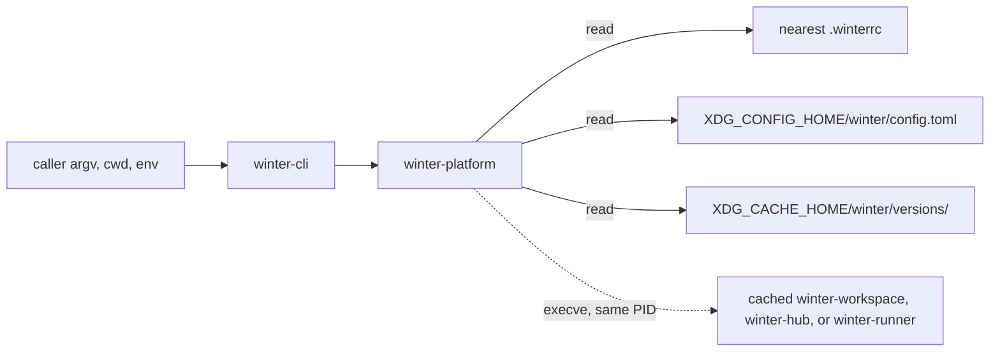

# Winter launcher shim spec

## System



| Module (`winter-platform/src/`) | Change                                                                                           |
| ------------------------------- | ------------------------------------------------------------------------------------------------ |
| `process.rs`                    | Loses its `cfg(dev-sample)` gate; `Process` and `UnixProcess` serve production dispatch          |
| `dispatch.rs`                   | New: role parsing, version resolution, manifest validation, `ExecRequest` construction           |
| `selection.rs`                  | New: `.winterrc` discovery, user config loading, version-string validation                       |
| `cli.rs`                        | Registers `workspace`, `hub`, `runner` as raw-tail groups at the same site as the sample adapter |
| `sample.rs`                     | Unchanged; keeps `WINTER_DEV_SAMPLE_PATH` and stays development-only                             |

`winter-cli/src/main.rs` injects the environment values below; dispatch code never calls `std::env` itself.

| Input             | Source                                      | Default when unset or empty                            |
| ----------------- | ------------------------------------------- | ------------------------------------------------------ |
| `cwd`             | `std::env::current_dir()`                   | Required; failure exits 126                            |
| `HOME`            | `var_os("HOME")`                            | Required when an XDG value is unset; failure exits 126 |
| `XDG_CONFIG_HOME` | `var_os("XDG_CONFIG_HOME")`, absolute only  | `$HOME/.config`                                        |
| `XDG_CACHE_HOME`  | `var_os("XDG_CACHE_HOME")`, absolute only   | `$HOME/.cache`                                         |
| Host target       | Build-time `TARGET`, exported by `build.rs` | Compiled in                                            |

A relative XDG value is ignored, per the XDG base-directory specification. Tests isolate the shim by setting `HOME`,
both XDG variables, and `cwd` to fixture directories (`engineering:fixture-only-dispatch`).

## Domain

```rust
use std::{ffi::OsString, path::PathBuf};

pub enum Role {
    Workspace, // group "workspace", executable "winter-workspace"
    Hub,       // group "hub",       executable "winter-hub"
    Runner,    // group "runner",    executable "winter-runner"
}

/// Exact release version, e.g. "1.4.0" or "2.0.0-rc.1". No ranges, aliases, or "latest".
/// Grammar: MAJOR.MINOR.PATCH[-PRERELEASE] with numeric parts lacking leading zeros and PRERELEASE in
/// [0-9A-Za-z.-]. Validation precedes any path join, so a version can never contain "/" or "..".
pub struct Version(String);

pub enum SelectionSource {
    Pin { file: PathBuf },     // nearest .winterrc; Role::Workspace only
    UserDefault { file: PathBuf },
}

pub struct Selection {
    pub role: Role,
    pub version: Version,
    pub source: SelectionSource, // carried into every dispatch diagnostic
}

pub struct DispatchRequest {
    pub role: Role,
    pub args: Vec<OsString>, // every token after the group, unchanged
}

pub struct DispatchEnv {
    pub cwd: PathBuf,
    pub config_home: PathBuf,
    pub cache_home: PathBuf,
    pub target: &'static str,
}
```

```text
selection order (decision:launcher-shim/version-scope)
  Workspace: nearest .winterrc with versions.workspace -> config.toml versions.workspace -> NoSelection
  Hub:       config.toml versions.hub                                                  -> NoSelection
  Runner:    config.toml versions.runner                                               -> NoSelection
A .winterrc that exists but lacks versions.workspace does not stop the walk to the user default.
```

## Interfaces

```text
winter workspace [ARG...]
winter hub [ARG...]
winter runner [ARG...]
```

Each group uses the foundation's first-token adapter: the first token is compared as an `OsStr`, every later token is
passed through unchanged without clap normalization, and root `--help` lists the three groups. `winter --help` and
`winter --version` never read `.winterrc`, user config, or the cache (`product:respect-component-version`). Any other
first token stays a clap usage error, exit 2 (`product:explain-dispatch-failure`).

```rust
pub enum DispatchError {
    NoSelection { role: Role, searched: Vec<PathBuf> },                // 127
    InvalidConfig { file: PathBuf, reason: String },                   // 126
    NotCached { selection: Selection, dir: PathBuf },                  // 127
    InvalidManifest { selection: Selection, file: PathBuf, reason: String }, // 126
    IncompatibleHandoff { selection: Selection, handoff: u32 },        // 126
    Replacement { selection: Selection, executable: PathBuf, source: std::io::Error }, // 126
}

pub fn resolve(role: Role, env: &DispatchEnv) -> Result<Selection, DispatchError>;
pub fn prepare(selection: &Selection, req: DispatchRequest, env: &DispatchEnv) -> Result<ExecRequest, DispatchError>;
pub fn run_dispatch(req: DispatchRequest, env: &DispatchEnv, process: &mut dyn Process)
    -> Result<std::convert::Infallible, DispatchError>;
pub fn dispatch_failure_reply(error: DispatchError) -> Reply;
```

| Outcome                    | stdout      | stderr                                                                       | Exit                         |
| -------------------------- | ----------- | ---------------------------------------------------------------------------- | ---------------------------- |
| Replacement succeeds       | Component's | Component's                                                                  | Component's status or signal |
| `NoSelection`, `NotCached` | Empty       | `winter: cannot run <role>: …`, the files searched or the expected directory | 127                          |
| Any other `DispatchError`  | Empty       | `winter: cannot run <role> <version> (from <source file>): …`                | 126                          |

Every launcher diagnostic starts with `winter: cannot run`, so a launcher failure reads differently from a component's
own error. Exit 126 and 127 follow the shell convention for "found but cannot run" and "not found". No failure path
retries another version, searches PATH, or writes a file (`product:explain-dispatch-failure`).

| Handoff field  | Contract                                                                                            |
| -------------- | --------------------------------------------------------------------------------------------------- |
| Executable     | `<cache>/winter/versions/<role>/<version>/<target>/<manifest.executable>`, direct `execve`, no PATH |
| `argv[0]`      | The selected executable path                                                                        |
| Arguments      | Every token after the group, unchanged `OsString` values                                            |
| cwd, fds 0/1/2 | Inherited unchanged                                                                                 |
| Environment    | Inherited snapshot plus `WINTER_INVOKED_AS=winter <group>`, replacing any inherited value           |
| Process        | Same PID via `execve`; the component owns exit status and signals (`product:preserve-invocation`)   |

```text
# component side of the handoff, handoff = 1 (product:invocation-aware-help)
WINTER_INVOKED_AS set and nonempty -> use it as the usage prefix in help, nested help, and usage errors
WINTER_INVOKED_AS unset or empty   -> use the component's own executable name
read once at startup, then removed from the component's environment so child processes never inherit it
never affects component identity, --version output, or behavior other than displayed prefixes
```

The shim supports handoff version `1` only. A later handoff version adds to this table and keeps accepting `1`.

## Flows

```text
args_os -> drop argv[0] -> first token in {workspace, hub, runner}?
  no  -> foundation parsing (help, version, sample, usage error)
  yes -> DispatchRequest { role, args = remaining tokens }
      -> resolve(role)
           Workspace: walk cwd, parent, ... "/" for .winterrc
                        found + parse error            -> InvalidConfig
                        found + versions.workspace     -> Pin
           all roles: read config.toml
                        missing file or key            -> NoSelection (searched files listed)
                        parse error / bad version      -> InvalidConfig
                        key present                    -> UserDefault
      -> prepare
           dir = cache/winter/versions/<role>/<version>/<target>/
           dir/component.toml missing                  -> NotCached
           parse error, role/version/target mismatch   -> InvalidManifest
           handoff not in {1}                          -> IncompatibleHandoff
           executable relative path escapes dir        -> InvalidManifest
           -> ExecRequest { executable, args, env + WINTER_INVOKED_AS }
      -> Process.replace
           error -> Replacement -> dispatch_failure_reply -> exit 126
           ok    -> component owns the process
```

No preflight checks the executable's existence or mode; `execve` reports `ENOENT` and `EACCES` as `Replacement`, which
avoids a check-then-exec race. Discovery stops at the first `.winterrc`. A lookup error other than not-found, such as an
unreadable ancestor, is `InvalidConfig` rather than a fall-through to the user default, so a pin is never skipped
silently.

## Data

```toml
# <workspace root>/.winterrc — decision:launcher-shim/version-selection
[versions]
workspace = "1.4.0"
```

```toml
# $XDG_CONFIG_HOME/winter/config.toml
[versions]
workspace = "1.4.0"
hub = "2.0.0"
runner = "1.9.2"
```

```toml
# $XDG_CACHE_HOME/winter/versions/runner/1.9.2/x86_64-unknown-linux-gnu/component.toml
# decision:launcher-shim/component-discovery
role = "runner"
version = "1.9.2"
target = "x86_64-unknown-linux-gnu"
handoff = 1
executable = "bin/winter-runner" # relative; normalized result must stay inside this directory
```

| File             | Unknown table or key | `hub` / `runner` key | Version string fails grammar |
| ---------------- | -------------------- | -------------------- | ---------------------------- |
| `.winterrc`      | Ignored              | `InvalidConfig`      | `InvalidConfig`              |
| `config.toml`    | Ignored              | Used                 | `InvalidConfig`              |
| `component.toml` | Ignored              | n/a                  | `InvalidManifest`            |

Unknown keys are ignored so later fields can be added without breaking older shims. A `hub` or `runner` key in
`.winterrc` is rejected rather than ignored, because `decision:launcher-shim/version-scope` keeps those roles off
workspace pins and a silently ignored pin would mislead. The shim never writes any of these files.
